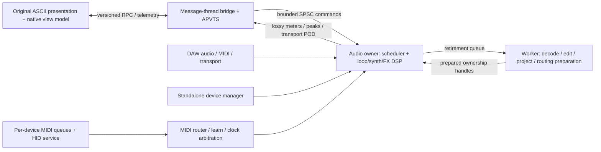

# Native architecture blueprint

## Reference audit

Source: `.reference/Ascii-Looper`, version string `v0.76.16`. It is a browser
application, not a native engine: no native build system was present at restart.
The reference has 10 initial / 20 expanded loops and drone instances (README counts
and runtime limits differ), plus a global voice pool, tracker, sample lab, effects,
project files, MIDI learn, hotkeys and gamepad input. Runtime files are inventoried
in `resources/reference-manifest.json`; their original licence notices are retained.
The `.reference/input-debug` CPAL material is diagnostic background, not a dependency.

| Reference module | Native owner | Boundary |
| --- | --- | --- |
| `audioEngine.js`, recorder/worklets | `AudioEngine`, `CaptureRouter`, `BufferPool` | Callback owns PCM and frame clock |
| `loopTracks.js`, `AudioGraph` | `LoopBank`, `LoopVoice`, `LoopScheduler`, `HistoryManager` | Immutable worker-prepared edits; callback swaps handles |
| `droneSynth.js` | `DroneBank`, `VoicePool`, `Oscillators`, `Envelope`, `ModulationMatrix` | Preallocated voices; sample-rate independent DSP |
| `tracker.js` | `Tracker`, `EventScheduler` | Absolute sample timestamps, not JS timers |
| `effects.js` | `FxRack`, typed effect processors, `MasterBus` | Prebuilt routing plans and smoothed parameters |
| `scales.js` | `TransportArbiter`, `ClockPLL`, `Metronome`, `Tuning` | Host/MIDI/internal clock; fixed-point tick phase |
| `projectManager.js` | `ProjectService`, codecs, migration adapters | Worker parsing/validation; versioned state |
| `main.js` MIDI/gamepad | `MidiRouter`, `LearnManager`, `ControllerService` | Normalize hardware messages before DSP |
| Original HTML/CSS/render helpers | `WebEditor`, frontend view-model adapter | State/commands/decimated telemetry only |

## Module graph

`aion_core` is JUCE-independent C++20. `AionLooper` owns JUCE wrappers, APVTS,
resource serving and platform services. `AionUi` contains the verified asset archive.
One shared processor produces all wrappers: do not fork DSP implementations by format.
IDs (`masterGain`, bundle ID, VST3 UID, AU codes, CLAP ID, LV2 URI) are compatibility
contracts; add explicit migrations before any incompatible state/parameter change.

## Real-time contract

- Allocate all capture storage, voices, delay lines, FFT workspaces, MIDI output storage
  and routing plans before activation or on workers. No `new`, `malloc`, delete,
  locks, filesystem, JSON, browser calls or device enumeration in `processBlock`.
- Audio thread is the sole mutable PCM/DSP owner. Message thread is the sole producer
  of its SPSC command queue. **Do not** put multiple MIDI callbacks onto that SPSC queue.
  Each standalone MIDI port gets its own bounded SPSC queue; a control-thread merger
  owns configuration. Plugin `MidiBuffer` events are consumed directly at sample offsets.
- Typed trivial commands carry absolute sample deadlines. Queue bounds, late-event
  policy and bounded per-block work are explicit. Current core caps execution at 128
  commands/block; excess pending commands become late, never trigger an unbounded loop.
  Producers must enqueue deadlines in order; this FIFO does not sort on the callback.
- Prepared buffer/routing/state swaps cross a bounded queue; old handles return to a
  worker retirement queue. Never free a last shared pointer on the audio thread.
- Telemetry may drop when full. Audio/MIDI commands must report overflow. MIDI note-off,
  sustain release and panic require reserved capacity to avoid stuck notes.
- Use 20 ms gain ramps initially; effect-specific smoothing must be validated against
  the reference. Avoid `-ffast-math` because it breaks finite-value protection.
- A 64/128-frame target is an acceptance test, not a latency guarantee. Stress-test
  all voices/effects and device/host paths at 44.1/48/96/192 kHz with worst-case CPU.
  Hardware/OS/device latency is measured separately from processor latency.
- Current core tests instrument C++ new/delete and audit allocation-free code; they do
  not certify all JUCE/host internals or interpose arbitrary C `malloc` calls.

## MIDI and controllers

Normalize source/device, channel, type, data1/data2, timestamp and generation into
fixed POD events. Preserve NoteOn velocity, NoteOff, CC, 14-bit pitch bend and Program
Change (including program 0). Handle sustain, all-notes-off and disconnect panic.

Learn runs on the control thread using a last-event mailbox. A mapping records target
stable ID, source filter, channel, kind, edge/toggle/momentary mode, range, curve,
inversion and soft takeover. Right-click/select-any-control arms learn via RPC.
Publish immutable bounded mapping tables; retire old tables outside audio. MIDI learn
never calls APVTS notifications from the callback. UI/host automation reconciliation
uses a message-thread dispatcher with begin/end gesture lifetimes.

FCB1010: PC selects scene/action, CC edge distinguishes press/release, expression
pedals use scaled continuous values. Oxygen: notes/velocity target voices, bend/mod
remain per-channel, knobs/faders use learn. HID/gamepads/dancepads use an optional
SDL3 service outside audio, mapping input edges to the same action schema; no synthetic
OS keystrokes are required. Add device-generation tokens and releases on disconnect.
Standalone MIDI routing uses explicit selected ports; plugin routing uses the host's
MIDI buses and never silently opens standalone hardware ports.

## Transport and timing

Priority: valid DAW host transport > selected external MIDI clock > internal master.
Capture host BPM, meter, PPQ, sample time, playing, recording, loop/cycle bounds once
per block; split scheduled events at exact offsets. Detect seeks, loop wraps and
source changes, rebase phase explicitly and never duplicate scheduled notes.

MIDI clock: 24 PPQN plus Start/Continue/Stop and Song Position Pointer. Input PLL needs
jitter rejection and a timeout/fallback policy. Output uses an audio-produced timestamp
queue and a dedicated dispatcher; no `MidiOutput::sendMessageNow` in the callback.
Prevent clock echo/feedback to its input source. Declare and test host limitations:
JUCE APVTS baseline parameter observation is block-level; sample-accurate automation
needs verified format-specific event paths (CLAP resolution is requested as 1 sample).
Current processor observes host BPM/PPQ/play only; **full synchronization is pending**.

## Web UI and IPC

Original runtime assets stay byte-for-byte preserved. Reuse layout, CSS, ASCII art,
control IDs and rendering code. Port behavior behind a view-model adapter; never
re-enable `AudioContext`, Worklets, MediaRecorder or Web MIDI in the native editor.
The preview therefore blocks legacy scripts and is read-only; dynamic panels are
pending adapter work. This is not 100% runtime UI or audio parity yet.

Use `juce::WebBrowserComponent`: forced WebView2 on Windows; native WebKit on Apple;
WebKitGTK on Linux with JUCE's embedded subprocess for plugin hosts. JUCE's resource
provider serves the ZIP in memory without a local HTTP listener or filesystem URL.
Navigation/new windows are denied outside the local resource origin. No remote CDN
or arbitrary `eval`/file APIs are allowed in the bridge.

Protocol 1 request/reply is `window.AionNative.request({operation,...})`, bounded to
128 outstanding requests, with timeout/session-close rejection. Implemented operations:
`hello` and `setParameter {id:"masterGain",value:0..2}`. JUCE marshals replies as values,
not concatenated JavaScript. Message thread validates IDs/types/ranges. Future commands
carry request/session/generation IDs and typed actions. Project/decoder jobs are async
workers, never message-thread blocking tasks. Visualizers receive decimated peaks,
not full-rate PCM or cloned recording buffers. Meter publication is lossy and bounded.

## State, parity and release sequence

1. **This commit:** pinned CMake formats, core/queue contract, APVTS master, hosted
   transport observation, resource preservation, read-only browser preview and bridge.
2. Native record/play/stop/overdub/substitute with deterministic PCM parity; complete
   original loop-card view adapter before enabling those controls.
3. Device routing, MIDI learn/controller profiles, panic and hardware reconnection.
4. Full transport arbitration, quantization, tracker and clock I/O.
5. Drone voices, sampler, FX algorithms/routing, sample lab and offline rendering.
6. `.alp`/JSON importer, native versioned projects, preset/state/undo parity.
7. Cross-host validators, sanitizers, allocation/latency stress, signing/notarization,
   Apple provisioning/AUv3 host lifecycle, installers and licensing review.

Do not label this a commercial release until every PARITY row has fixtures and host/
hardware validation. No Rust binary or code from the aborted migration is resurrected.
