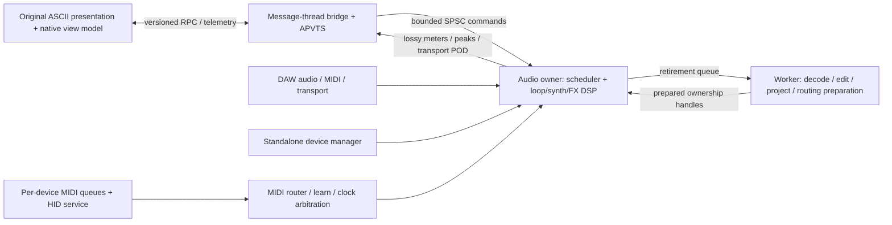

# Native architecture blueprint

## Reference audit

Source: `.reference/Ascii-Looper`, version string `v0.76.16`. It is a browser
application, not a native engine: no native build system was present at restart.
The reference has 10 initial / 20 expanded loops and drone instances (README counts
and runtime limits differ), plus a global voice pool, tracker, sample lab, effects,
project files, MIDI learn, hotkeys and gamepad input. Runtime files are inventoried
in `resources/reference-manifest.json`; their original licence notices are retained.
The `.reference/input-debug` CPAL material is diagnostic background, not a dependency.

| Reference module | Native owner | Boundary |
| --- | --- | --- |
| `audioEngine.js`, recorder/worklets | `AudioEngine`, `CaptureRouter`, `BufferPool` | Callback owns PCM and frame clock |
| `loopTracks.js`, `AudioGraph` | `LoopBank`, `LoopVoice`, `LoopScheduler`, `HistoryManager` | Immutable worker-prepared edits; callback swaps handles |
| `droneSynth.js` | `DroneBank`, `VoicePool`, `Oscillators`, `Envelope`, `ModulationMatrix` | Preallocated voices; sample-rate independent DSP |
| `tracker.js` | `Tracker`, `EventScheduler` | Absolute sample timestamps, not JS timers |
| `effects.js` | `FxRack`, typed effect processors, `MasterBus` | Prebuilt routing plans and smoothed parameters |
| `scales.js` | `TransportArbiter`, `ClockPLL`, `Metronome`, `Tuning` | Host/MIDI/internal clock; fixed-point tick phase |
| `projectManager.js` | `ProjectService`, codecs, migration adapters | Worker parsing/validation; versioned state |
| `main.js` MIDI/gamepad | `MidiRouter`, `LearnManager`, `ControllerService` | Normalize hardware messages before DSP |
| Original HTML/CSS/render helpers | `WebEditor`, frontend view-model adapter | State/commands/decimated telemetry only |

## Module graph

`aion_core` is JUCE-independent C++20. `AionLooper` owns JUCE wrappers, APVTS,
resource serving and platform services. `AionUi` contains the verified asset archive.
One shared processor produces all wrappers: do not fork DSP implementations by format.
IDs (`masterGain`, bundle ID, VST3 UID, AU codes, CLAP ID, LV2 URI) are compatibility
contracts; add explicit migrations before any incompatible state/parameter change.

## Real-time contract

- Allocate all capture storage, voices, delay lines, FFT workspaces, MIDI output storage
  and routing plans before activation or on workers. No `new`, `malloc`, delete,
  locks, filesystem, JSON, browser calls or device enumeration in `processBlock`.
- Audio thread is the sole mutable PCM/DSP owner. Message thread is the sole producer
  of its SPSC command queue. **Do not** put multiple MIDI callbacks onto that SPSC queue.
  Each standalone MIDI port gets its own bounded SPSC queue; a control-thread merger
  owns configuration. Plugin `MidiBuffer` events are consumed directly at sample offsets.
- Typed trivial commands carry absolute sample deadlines. Queue bounds, late-event
  policy and bounded per-block work are explicit. Current core caps execution at 128
  commands/block; excess pending commands become late, never trigger an unbounded loop.
  Producers must enqueue deadlines in order; this FIFO does not sort on the callback.
- Prepared buffer/routing/state swaps cross a bounded queue; old handles return to a
  worker retirement queue. Never free a last shared pointer on the audio thread.
- Telemetry may drop when full. Audio/MIDI commands must report overflow. MIDI note-off,
  sustain release and panic require reserved capacity to avoid stuck notes.
- Use 20 ms gain ramps initially; effect-specific smoothing must be validated against
  the reference. Avoid `-ffast-math` because it breaks finite-value protection.
- A 64/128-frame target is an acceptance test, not a latency guarantee. Stress-test
  all voices/effects and device/host paths at 44.1/48/96/192 kHz with worst-case CPU.
  Hardware/OS/device latency is measured separately from processor latency.
- Current core tests instrument C++ new/delete and audit allocation-free code; they do
  not certify all JUCE/host internals or interpose arbitrary C `malloc` calls.

## MIDI and controllers

Normalize source/device, channel, type, data1/data2, timestamp and generation into
fixed POD events. Preserve NoteOn velocity, NoteOff, CC, 14-bit pitch bend and Program
Change (including program 0). Handle sustain, all-notes-off and disconnect panic.

Learn runs on the control thread using a last-event mailbox. A mapping records target
stable ID, source filter, channel, kind, edge/toggle/momentary mode, range, curve,
inversion and soft takeover. Right-click/select-any-control arms learn via RPC.
Publish immutable bounded mapping tables; retire old tables outside audio. MIDI learn
never calls APVTS notifications from the callback. UI/host automation reconciliation
uses a message-thread dispatcher with begin/end gesture lifetimes.

FCB1010: PC selects scene/action, CC edge distinguishes press/release, expression
pedals use scaled continuous values. Oxygen: notes/velocity target voices, bend/mod
remain per-channel, knobs/faders use learn. HID/gamepads/dancepads use an optional
SDL3 service outside audio, mapping input edges to the same action schema; no synthetic
OS keystrokes are required. Add device-generation tokens and releases on disconnect.
Standalone MIDI routing uses explicit selected ports; plugin routing uses the host's
MIDI buses and never silently opens standalone hardware ports.

## Transport and timing

Priority: valid DAW host transport > selected external MIDI clock > internal master.
Capture host BPM, meter, PPQ, sample time, playing, recording, loop/cycle bounds once
per block; split scheduled events at exact offsets. Detect seeks, loop wraps and
source changes, rebase phase explicitly and never duplicate scheduled notes.

MIDI clock: 24 PPQN plus Start/Continue/Stop and Song Position Pointer. Input PLL needs
jitter rejection and a timeout/fallback policy. Output uses an audio-produced timestamp
queue and a dedicated dispatcher; no `MidiOutput::sendMessageNow` in the callback.
Prevent clock echo/feedback to its input source. Declare and test host limitations:
JUCE APVTS baseline parameter observation is block-level; sample-accurate automation
needs verified format-specific event paths (CLAP resolution is requested as 1 sample).
Current processor observes host BPM/PPQ/play only; **full synchronization is pending**.

## Web UI and IPC

Original runtime assets stay byte-for-byte preserved. Reuse layout, CSS, ASCII art,
control IDs and rendering code. Port behavior behind a view-model adapter; never
re-enable `AudioContext`, Worklets, MediaRecorder or Web MIDI in the native editor.
The preview therefore blocks legacy scripts and is read-only; dynamic panels are
pending adapter work. This is not 100% runtime UI or audio parity yet.

Use `juce::WebBrowserComponent`: forced WebView2 on Windows; native WebKit on Apple;
WebKitGTK on Linux with JUCE's embedded subprocess for plugin hosts. JUCE's resource
provider serves the ZIP in memory without a local HTTP listener or filesystem URL.
Navigation/new windows are denied outside the local resource origin. No remote CDN
or arbitrary `eval`/file APIs are allowed in the bridge.

Protocol 1 request/reply is `window.AionNative.request({operation,...})`, bounded to
128 outstanding requests, with timeout/session-close rejection. Implemented operations:
`hello` and `setParameter {id:"masterGain",value:0..2}`. JUCE marshals replies as values,
not concatenated JavaScript. Message thread validates IDs/types/ranges. Future commands
carry request/session/generation IDs and typed actions. Project/decoder jobs are async
workers, never message-thread blocking tasks. Visualizers receive decimated peaks,
not full-rate PCM or cloned recording buffers. Meter publication is lossy and bounded.

## State, parity and release sequence

1. **This commit:** pinned CMake formats, core/queue contract, APVTS master, hosted
   transport observation, resource preservation, read-only browser preview and bridge.
2. Native record/play/stop/overdub/substitute with deterministic PCM parity; complete
   original loop-card view adapter before enabling those controls.
3. Device routing, MIDI learn/controller profiles, panic and hardware reconnection.
4. Full transport arbitration, quantization, tracker and clock I/O.
5. Drone voices, sampler, FX algorithms/routing, sample lab and offline rendering.
6. `.alp`/JSON importer, native versioned projects, preset/state/undo parity.
7. Cross-host validators, sanitizers, allocation/latency stress, signing/notarization,
   Apple provisioning/AUv3 host lifecycle, installers and licensing review.

Do not label this a commercial release until every PARITY row has fixtures and host/
hardware validation. No Rust binary or code from the aborted migration is resurrected.

## Native loop milestone (0.2.0)

`LoopBank` uses 2,048 preallocated blocks of 4,096 stereo frames (64 MiB), shared
among 20 track slots. Metadata/free stacks are fixed arrays. The audio owner alone
acquires/recycles blocks; recording never resizes a vector. Free-space exhaustion
finishes the captured loop into playback and publishes a memory-full flag. Stored
samples are guarded to +/-8 for finite headroom; the output guard is +/-1. Overdub
uses stored PCM * feedback + input (default 80%); substitute replaces it. Edits become
audible on the next pass, independently of optional input monitoring. Start/wrap
blends and stop tails avoid abrupt boundary jumps; volume/mute move per sample.

Typed loop commands carry track, action, value, request ID, generation and optional
absolute sample deadline. GUI commands apply at the next audio callback. The queue
has 255 entries, executes at most 128 commands/block and rejects overflow. A prepare
increments generation; stale commands are rejected. Only the message thread drains
snapshot queues; prepare never acts as a second consumer. Same-rate prepare retains
PCM and stops transport. Rate changes currently clear session PCM and report that
reset; resampling/project persistence are not implemented yet.

Native RPC adds `snapshot` and `loop {action, track, value, generation, expiresAt}`.
`expiresAt` is a short UNIX-millisecond deadline checked on the message thread, so
an old UI event cannot start recording after a long message-thread stall. Accepted
commands remain queued during an audio pause and acknowledge through a coherent
snapshot once processing resumes. The GUI permits one outstanding loop action;
there is no optimistic audio-state mutation. Protocol version remains 1.

Four pure presentation methods and effect colours are copied from the original
reference into `loop-view.js`; tests compare the method text (line endings normalized).
The generated cards retain the original controls and CSS. The adapter removes
inline handlers, enables only implemented controls and polls lossy snapshots.
No original recorder, AudioContext, Worklet, MIDI or CDN script is executed. Project
save/export and undo are visibly unavailable; the preview must not imply that DAW
parameter XML contains recorded audio.

## Reference UI contract (0.3.0)

Original assets remain byte-identical and presentation is adapted externally.
There is no separate native preview toolbar. Original session buttons, mode
shortcuts, module placement and workspace/manual navigation are reused. Native
input/monitor status lives inside INPUT MIXER and output volume inside MASTER
OUTPUT. New configuration surfaces must use the original ASCII styles and stay
limited to native audio/input/MIDI needs. Unported controls remain visible and
disabled, with no substitute browser DSP.

SOLO is audio-owned exclusive gating, preserving each loop's explicit mute and
continuing the phase of excluded loops; clearing the selected solo cancels solo.
RTRG restarts retained PCM at sample zero in manual timing. These are not host
quantization or sync support. Auto-play after Rec is a cached APVTS boolean read
at block boundaries. Clear-all recycles the bounded pool without freeing memory.
Live volume/feedback inputs coalesce their latest values while another native
command is awaiting acknowledgement; this queue is message-thread only.

## Pan and varispeed (0.4.0)

The loop graph's `_addPanControl` in the reference connects both stereo GainNodes
to separate mono ChannelMerger inputs. Native output therefore computes
`mono=(L+R)/2`, then `L=mono*cos(pan*pi/20)` and `R=mono*sin(pan*pi/20)`.
This includes the original center attenuation. The downmix follows the
[Web Audio channel mixing specification](https://www.w3.org/TR/webaudio-1.0/#channel-up-mixing-and-down-mixing);
no Web Audio code runs in the native application. Stereo PCM in the pool is not
modified by pan or mute. Gain endpoints ramp independently over 20 ms, as in the
reference scheduled fades.

Each track owns a double-precision source-frame phase, fractional linear reader
and a bounded 20 ms rate ramp. Advance and wrap are per sample and independent
of host block size. Only the published integer source position goes to the UI;
source length remains unchanged and displayed duration divides by target rate.
The original manual rate range and half/reset semantics are retained. Unity-speed
overdub/substitute remain integer PCM writes; entry requires rate=1 with its ramp
settled, snaps phase to the current source frame and crossfades the transition.
Active capture rejects rate changes. Reference sync-dependent speed quantization
is not implemented because native sync is still off. Linear interpolation can
alias at increased rates; an antialiasing resampler and perceptual/browser audio
fixtures are required before claiming commercial DSP parity.

## Reference acceptance gates (0.4.1)

Single capture ownership follows LoopManager; all 20 slots still play together.
Clear preserves explicit mute as the reference does. Empty capture finalization
releases ownership without stranding the recorder. State parity now uses actual
unchanged JS classes, with VM stubs restricted to browser/audio IO.

State and sound acceptance are distinct. `AudioParityAudit.cjs` currently fails
against the unchanged circular mixer. Future capture processing must record into
preallocated take storage, transfer ownership for non-realtime finalization,
apply reference DC/crossfade/mix/clipping routines off the callback, and commit
an immutable result at an audio block boundary. Old PCM must survive exhaustion,
cancellation and reset. Undo/export/project persistence should use the same
ownership mechanism. This describes required work, not an implemented pipeline.

## Connected capture transactions (0.4.2, supersedes direct-write preview)

LoopBank now owns a setup-allocated capture pool and an offline worker. Fresh
recording and edit takes write only into that pool. The committed clip is immutable,
so an overdub never changes the playing samples before FINISH. FINISH transfers
pinned block IDs and immutable job metadata through a release/acquire state
handshake. No full-clip scan/copy/allocation happens in apply/processBlock.

The worker assembles planar take storage and executes the reference routines:
fresh take crossfade 15 ms then DC removal; edit DC removal then 8 ms crossfade,
then circular tapered/soft-clipped mix into a private copy of the old clip.
Successful results commit in beginBlock; stale revisions discard the result.
Stop during finalization prevents autoplay, clear cancels through a revision, and
prepare joins the worker before rate/storage reset. On allocation/processing failure
the old clip remains valid and the UI reports failure. SAVING reuses the original
main-button presentation, without adding a feature panel.

A committed clip has one audio lease; a processing job takes an independent atomic
lease before publication. Only the worker decrements/deletes released leases. This
protects a job queued immediately before clear: the old clip cannot be destroyed
before the worker starts reading it. A 64-entry SPSC retirement queue exceeds the
20 track leases plus the single transaction/commit backlog. On queue overflow the
worker retains storage until stopped prepare, never deleting on the audio owner.
Audio-owned track/job revisions and free-block lists are not read by the UI.

The logical committed-clip budget still follows the configured pool capacity,
rounded to blocks (64 MiB by default); edit capture has its own reusable take pool.
Actual memory is higher than the previous single-pool claim: immutable resident
PCM, a private result and planar worker scratch add transient memory. At maximum
size the data path can approach 224 MiB per instance, excluding JUCE/WebView/host
memory. Allocation failure is handled off the callback and rolls back edits.
Mobile/large-instance memory and hardware latency require platform validation.

Worker completion latency is asynchronous, matching the reference finalization
model. Sample-command/block invariance is tested after committed stopped clips
are ready; it is not a claim that arbitrary thread scheduling gives an identical
FINISH-to-play delay. Existing 64/128 playback/pan/rate command regressions remain.
Audio new/delete instrumentation now watches the simulated callback thread via
thread-local state; worker allocations are legitimate and are tested separately
with forced failure, ASan/UBSan and TSan.

### Native normalization transaction (0.4.3)

NORM reuses the single immutable-clip job slot with a retained base lease and zero
capture blocks. The worker clones both planar channels, finds their shared peak
and applies the reference normalization ratio. The audio owner swaps only a
completed clip pointer at beginBlock, retaining current phase and playback intent,
and applies the existing short transition blend. Clear invalidates its revision;
Stop suppresses playback; prepare joins before resetting storage. Failed worker
allocation keeps the old clip. Full scans, copies and allocation/deletion remain
off the callback. Like other jobs, this can temporarily require a second resident
clip; the existing peak transient memory budget already accounts for that copy.

### Reverse source identity

LoopView.reverse is the requested direction. Track.activeReverse is latched only
when a source starts/retriggers. The read maps source indices i and next(i) to
length-1-i and length-1-next(i), then uses the existing fractional interpolation,
wrap blend, pan and gain paths. The stored capture/edit PCM is never reversed.

When NORM replaces stored PCM while a reversed source is active, ownership of the
old audio clip lease transfers to Track.reverseHold. This preserves the reference
Web Audio reversed-buffer snapshot without a callback copy/allocation. Subsequent
NORM jobs still edit the current stored clip, while playback reads reverseHold.
The next play/retrigger, successful capture/edit restart, Stop, Clear and stopped
prepare release the hold through the existing worker retirement queue. Job base
leases remain independent, so Clear during a worker operation remains safe.

There is at most one held source per slot. These holds can add up to one extra
resident PCM budget (64 MiB at the default capacity) to the previous nominal
working set; allocator/JUCE/WebView and deferred retirement also consume memory.
Do not treat the earlier capture-pool size or transient estimates as a hard
process-memory cap. Twenty held sources and Clear All are exercised under the
callback allocation watch and sanitizers. No reverse caches grow with toggles.

### Immutable Undo/Redo ownership

Each track has fixed arrays for five undo and five redo handles; their combined
live depth never exceeds five. A successful overdub/substitute commit transfers
its old current-clip lease into undo. The worker result becomes current. Eviction
and redo-branch deletion enqueue leases for worker-only release. NORM does not
save history. Undo/Redo transfer the current lease into the opposite stack and
restore a saved handle without a copy, allocation or deletion on the callback.
Controls remain separate from audio history. Playing restores restart phase/source
and blend; stopped restores remain stopped. Same-track in-flight edits are guarded.

Global history consists of fixed 50-entry track-ID arrays. Append, latest removal,
eviction and clear use bounded scans/shifts, matching the JS order semantics.
A new edit clears global redo and only its own local redo branch. Snapshots carry
per-loop depths and global target IDs through the existing SPSC telemetry. Failed
or invalidated worker transactions never alter history or discard a redo branch.

Clear and stopped prepare release history with the existing ownership rules. The
retirement queue now has 256 entries, covering 20 current clips, 20 held reverse
sources, at most 100 history leases and an in-flight job/result. The registry is
worker-owned; any registry growth remains outside audio processing. Maximal-history
Clear All/cancellation and all 20 held sources are covered by sanitizer/allocation
checks. History copies are avoided by retaining immutable generations, so a
callback history operation performs pointer and metadata work only.

Snapshots consume memory beyond the 64 MiB capture pool. With fixed clip lengths,
five generations across the full resident budget can retain another 320 MiB.
With Multiply and unequal-length history, that estimate no longer bounds retained
PCM: up to 100 historical clip handles may refer to older, larger clips, each
limited individually by the resident capacity. A conservative 100 x 64 MiB bound
is 6.25 GiB, before current clips, held reverse sources, worker scratch/results,
deferred retirement, JUCE and WebView. This is not a hard process cap or a measured
working set. Memory-pressure/mobile acceptance remains pending. Same-rate engine reprepare stops and retains history; rate/capacity reset
joins the worker and clears it. No project/DAW PCM persistence is implied.

### Multiply and unequal clip lengths

`multiply` toggles an input capture on a playing loop at unity speed (the reference's
0.01 tolerance is retained; a native rate ramp must first settle). The command's
input-availability flag is resolved by C++: Standalone checks the active input
channels and JUCE's input mute, plugins check their enabled input bus. The UI
cannot override this routing decision. A stopped loop, or a playing loop without
input, instead requests a worker doubling transaction. No new UI is introduced.

Interactive capture keeps the old clip audible. Fewer than 128 frames return the
capture blocks and resume unchanged, with no checkpoint or source restart. Other
takes pass the unchanged DC-removal / 8ms crossfade order on the worker, then append
after the complete old clip without rounding to a multiple or replacing samples.
Doubling copies the original twice without additional DSP. The callback only
publishes/accepts the job; failed allocation and revision cancellation retain the
old clip/history. Stop suppresses late autoplay; successful playing commits reset
the source using the requested reverse direction. Stopped doubles remain stopped.

Multiply calls the equivalent of `Loop.saveStateForUndo`, not `pushUndoState`:
it adds a five-deep local checkpoint but does not append global undo or clear
global redo. This includes the reference's potentially stale global redo head
when its local branch is discarded. General overdub/substitute rules above are
unchanged. The per-loop history control is the reliable way to undo MULT.

The current-PCM budget now reserves rounded growth for captured/pending Multiply
jobs. Capture auto-finishes at the exact remaining frame limit; doubling and
restoring a longer history clip reject before changing ownership if other current
clips/captures/reserved growth leave insufficient room. The job caches its base
length so admission/telemetry never dereference a worker-released canceled base.
Retained history and reverse-source leases still consume additional memory beyond
the resident/capture budget; the limit is not a hard process working-set cap.

Like the existing NORM/edit path, one capture/finalization owns the worker lane;
MULT is guarded while another track captures or finalizes (including stopped
doubling). Undo/Redo and retrigger are unavailable on a track being captured or
finalized. These native transaction guards are explicit limits on interaction
parity; concurrent edits and full browser lifecycle behavior are not established.

### Native main workflow and master grid

`SyncClock` is owned by the audio thread. OFF is the low-level core default (the
older DSP probes therefore keep their contracts); the app's APVTS default is
DYNAMIC, matching the original HTML. BPM, bar count, numerator/denominator and
visual count-in now persist as parameters. The clock uses the reference bar/grid
formulas: beats-per-bar is the numerator, and the denominator is stored/displayed
without changing those formulas. Master BPM is the only enabled sync source.
Host tempo/PPQ observation remains separate from this internal master clock.

Each of 20 tracks has fixed start/end deadlines. STATIC reserves its planned
resident PCM before entering ARMED; another recording/edit cannot steal that lane.
The first future grid with the reference 30ms lead is selected; visual count-in
adds one bar when the lead is less than 75% of a bar. A second main press cancels
an arm, and queued PLAY/STOP use the same sample grid. STOP NOW, Stop All, clear
and reset cancel deadlines without allowing later playback/capture resurrection.
A deadline within four double-precision epsilons of an integer sample is snapped
to that integer before ceiling; actual fractional deadlines retain their ceiling.

STATIC captures its planned frames plus a maximum 20ms splice tail instead of
waiting for the browser's 200ms delivery padding. The worker executes the actual
reference extraction order: fixed-size zero-filled output, copied capture, at
most 20ms of tail folded/clamped at the start; otherwise the reference end fade
and 10ms crossfade; then DC removal. Prefix rounding follows the unchanged
floor((targetTime - firstCapturedTime) * sampleRate) expression. Two recent input
samples are retained as POD values so a floor boundary preceding the scheduled
sample is not lost; no full pre-roll buffer or callback allocation is needed.
The take pool still bounds physical capture, including tail/prefix. Failed worker
allocation returns the reservation and preserves existing audio atomically.

DYNAMIC starts at the tap, as the current reference does (its pre-buffer does not
recover pre-tap audio). The first FINISH schedules the next bar unless the bar
ends within 50ms; the second tap forces finish now. The worker rounds the raw
length to a bar count and trims only when that rounded length is shorter than
captured audio, then applies the original 15ms crossfade and DC pass. Short or
fractional-bar takes are not padded. Mode, BPM, bar duration and origin are latched
for the active capture; changed settings affect later takes and playback without
retiming an in-flight extraction. Stop All bypasses waiting and suppresses autoplay.

Source starts use shared-grid phase, including after asynchronous worker commit.
The reference effectivePlaybackRate rule is retained for non-dynamic recorded
clips; dynamic clips keep their manual rate. Tempo changes preserve elapsed beat
phase by moving the master origin. Undo/Redo recompute the rate for restored clip
lengths. Processing/scheduling remains bounded to 20 slots and uses no locks,
allocation, deletion or full-clip scans on the callback. Hardware latency, browser
resampling/envelopes and sample-accurate DAW/MIDI clock following are not implied.

The original main buttons, number keys and shifted bank call one performance
controller. Mouse pointer capture handles release outside the button; pointer
cancel, lost capture and blur discard holds. Browser timer calls use arrow wrappers
so the WebView's Window functions never receive the controller timer object as
`this`. A >=600ms release can recover a delayed timer exactly once; cancellation
never invents a hold. The subsequent browser click is ignored for real pointer
presses, while keyboard/assistive click activation still works. Original timeline
marker rendering is reused, and visual count-in pulses the existing master module.
The frontend submits intent; sample deadlines and capture state live in C++.

Held main gestures latch their starting state before dispatching the short action.
Two message-thread timers separate the 600ms playback cut from the user-requested
4000ms deletion. Only STOP/STOP NOW origins can delete; PLAY/FINISH/CANCEL/RECORD
cannot. At dispatch the queued resolver additionally checks current state.
Monotonic elapsed time prevents early deletion if a timer fires before 4000ms;
an early callback reschedules the remaining interval. Deferred timers recover
once on release only if the full threshold elapsed. Cancellation/blur/STOP ALL
clear both timers and never recover deletion. Original EN/ES/PT manual panels
explain this policy, which supersedes the old 600ms quick-delete threshold.
Only message-thread routing changes; DSP and sample scheduling are unchanged.

Queued hold commands carry a message-thread validity predicate capturing a global
interaction epoch and per-track epoch. Dispatch checks validity immediately before
producing a command. Cancel/blur/STOP ALL and audio-generation changes invalidate
global epochs, including holds already released into the queue. Pointer cancellation
invalidates its press; DEL increments only that track's epoch and cancels its active
presses before enqueuing CLEAR. Ordinary >=4s release retains authorization until
cancelled or dispatched, so a delayed but valid deletion still works. These tokens
cannot retract a command already sent to the audio owner. No C++/DSP changes occur.

An accepted main gesture resolving during finalization returns the queue wait
sentinel. Pump puts the same item back at the head and yields; the next snapshot
poll retries. This preserves rapid record/finish/play ordering without spinning,
new timers or changed expiry. Priority STOP ALL removes unsent/deferred gestures.
The SAVING control's original appearance/disabled state remains unchanged.

Each local queued intent carries its track ID; global actions are unscoped.
Explicit DEL first cancels the track's hold epoch, then enqueues a scoped clear.
Admission removes that track's unsent intents and places CLEAR ahead of ordinary
FIFO work, after any pending STOP ALL/earlier scoped clears. Thus a finalization
wait cannot block clearing. Other tracks retain their relative order, and a
command already dispatched still completes before CLEAR. Original 128-item
capacity, expiry and generation validation remain. Global STOP ALL discards all
unsent work as before. No audio-thread or preserved reference asset changes occur.
