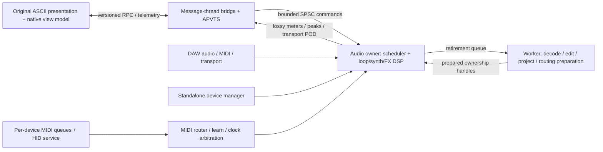

# Native architecture blueprint

For the audited current implementation versus planned modules, see
[MIGRATION_BLUEPRINT.md](MIGRATION_BLUEPRINT.md). The reference-to-native module
names in the initial design below include future components; they are not a claim
that synths, tracker, full clock sync or project persistence are already ported.

## Reference audit

Source: `.reference/Ascii-Looper`, version string `v0.76.16`. It is a browser
application, not a native engine: no native build system was present at restart.
The reference has 10 initial / 20 expanded loops and drone instances (README counts
and runtime limits differ), plus a global voice pool, tracker, sample lab, effects,
project files, MIDI learn, hotkeys and gamepad input. Runtime files are inventoried
in `resources/reference-manifest.json`; their original licence notices are retained.
The `.reference/input-debug` CPAL material is diagnostic background, not a dependency.

| Reference module | Native owner | Boundary |
| --- | --- | --- |
| `audioEngine.js`, recorder/worklets | `AudioEngine`, `CaptureRouter`, `BufferPool` | Callback owns PCM and frame clock |
| `loopTracks.js`, `AudioGraph` | `LoopBank`, `LoopVoice`, `LoopScheduler`, `HistoryManager` | Immutable worker-prepared edits; callback swaps handles |
| `droneSynth.js` | `DroneBank`, `VoicePool`, `Oscillators`, `Envelope`, `ModulationMatrix` | Preallocated voices; sample-rate independent DSP |
| `tracker.js` | `Tracker`, `EventScheduler` | Absolute sample timestamps, not JS timers |
| `effects.js` | `FxRack`, typed effect processors, `MasterBus` | Prebuilt routing plans and smoothed parameters |
| `scales.js` | `TransportArbiter`, `ClockPLL`, `Metronome`, `Tuning` | Host/MIDI/internal clock; fixed-point tick phase |
| `projectManager.js` | `ProjectService`, codecs, migration adapters | Worker parsing/validation; versioned state |
| `main.js` MIDI/gamepad | `MidiRouter`, `LearnManager`, `ControllerService` | Normalize hardware messages before DSP |
| Original HTML/CSS/render helpers | `WebEditor`, frontend view-model adapter | State/commands/decimated telemetry only |

## Module graph



`aion_core` is JUCE-independent C++20. `AionLooper` owns JUCE wrappers, APVTS,
resource serving and platform services. `AionUi` contains the verified asset archive.
One shared processor produces all wrappers: do not fork DSP implementations by format.
IDs (`masterGain`, bundle ID, VST3 UID, AU codes, CLAP ID, LV2 URI) are compatibility
contracts; add explicit migrations before any incompatible state/parameter change.

## Real-time contract

- Allocate all capture storage, voices, delay lines, FFT workspaces, MIDI output storage
  and routing plans before activation or on workers. No `new`, `malloc`, delete,
  locks, filesystem, JSON, browser calls or device enumeration in `processBlock`.
- Audio thread is the sole mutable PCM/DSP owner. Message thread is the sole producer
  of its SPSC command queue. **Do not** put multiple MIDI callbacks onto that SPSC queue.
  Each standalone MIDI port gets its own bounded SPSC queue; a control-thread merger
  owns configuration. Plugin `MidiBuffer` events are consumed directly at sample offsets.
- Typed trivial commands carry absolute sample deadlines. Queue bounds, late-event
  policy and bounded per-block work are explicit. Current core caps execution at 128
  commands/block; excess pending commands become late, never trigger an unbounded loop.
  Producers must enqueue deadlines in order; this FIFO does not sort on the callback.
- Prepared buffer/routing/state swaps cross a bounded queue; old handles return to a
  worker retirement queue. Never free a last shared pointer on the audio thread.
- Telemetry may drop when full. Audio/MIDI commands must report overflow. MIDI note-off,
  sustain release and panic require reserved capacity to avoid stuck notes.
- Use 20 ms gain ramps initially; effect-specific smoothing must be validated against
  the reference. Avoid `-ffast-math` because it breaks finite-value protection.
- A 64/128-frame target is an acceptance test, not a latency guarantee. Stress-test
  all voices/effects and device/host paths at 44.1/48/96/192 kHz with worst-case CPU.
  Hardware/OS/device latency is measured separately from processor latency.
- Current core tests instrument C++ new/delete and audit allocation-free code; they do
  not certify all JUCE/host internals or interpose arbitrary C `malloc` calls.

## MIDI and controllers

Normalize source/device, channel, type, data1/data2, timestamp and generation into
fixed POD events. Preserve NoteOn velocity, NoteOff, CC, 14-bit pitch bend and Program
Change (including program 0). Handle sustain, all-notes-off and disconnect panic.

Learn runs on the control thread using a last-event mailbox. A mapping records target
stable ID, source filter, channel, kind, edge/toggle/momentary mode, range, curve,
inversion and soft takeover. Right-click/select-any-control arms learn via RPC.
Publish immutable bounded mapping tables; retire old tables outside audio. MIDI learn
never calls APVTS notifications from the callback. UI/host automation reconciliation
uses a message-thread dispatcher with begin/end gesture lifetimes.

FCB1010: PC selects scene/action, CC edge distinguishes press/release, expression
pedals use scaled continuous values. Oxygen: notes/velocity target voices, bend/mod
remain per-channel, knobs/faders use learn. HID/gamepads/dancepads use an optional
SDL3 service outside audio, mapping input edges to the same action schema; no synthetic
OS keystrokes are required. Add device-generation tokens and releases on disconnect.
Standalone MIDI routing uses explicit selected ports; plugin routing uses the host's
MIDI buses and never silently opens standalone hardware ports.

## Transport and timing

Priority: valid DAW host transport > selected external MIDI clock > internal master.
Capture host BPM, meter, PPQ, sample time, playing, recording, loop/cycle bounds once
per block; split scheduled events at exact offsets. Detect seeks, loop wraps and
source changes, rebase phase explicitly and never duplicate scheduled notes.

MIDI clock: 24 PPQN plus Start/Continue/Stop and Song Position Pointer. Input PLL needs
jitter rejection and a timeout/fallback policy. Output uses an audio-produced timestamp
queue and a dedicated dispatcher; no `MidiOutput::sendMessageNow` in the callback.
Prevent clock echo/feedback to its input source. Declare and test host limitations:
JUCE APVTS baseline parameter observation is block-level; sample-accurate automation
needs verified format-specific event paths (CLAP resolution is requested as 1 sample).
Current processor observes host BPM/PPQ/play only; **full synchronization is pending**.

## Web UI and IPC

Original runtime assets stay byte-for-byte preserved. Reuse layout, CSS, ASCII art,
control IDs and rendering code. Port behavior behind a view-model adapter; never
re-enable `AudioContext`, Worklets, MediaRecorder or Web MIDI in the native editor.
The preview therefore blocks legacy scripts and is read-only; dynamic panels are
pending adapter work. This is not 100% runtime UI or audio parity yet.

Use `juce::WebBrowserComponent`: forced WebView2 on Windows; native WebKit on Apple;
WebKitGTK on Linux with JUCE's embedded subprocess for plugin hosts. JUCE's resource
provider serves the ZIP in memory without a local HTTP listener or filesystem URL.
Navigation/new windows are denied outside the local resource origin. No remote CDN
or arbitrary `eval`/file APIs are allowed in the bridge.

Protocol 1 request/reply is `window.AionNative.request({operation,...})`, bounded to
128 outstanding requests, with timeout/session-close rejection. Implemented operations:
`hello` and `setParameter {id:"masterGain",value:0..2}`. JUCE marshals replies as values,
not concatenated JavaScript. Message thread validates IDs/types/ranges. Future commands
carry request/session/generation IDs and typed actions. Project/decoder jobs are async
workers, never message-thread blocking tasks. Visualizers receive decimated peaks,
not full-rate PCM or cloned recording buffers. Meter publication is lossy and bounded.

## State, parity and release sequence

1. **This commit:** pinned CMake formats, core/queue contract, APVTS master, hosted
   transport observation, resource preservation, read-only browser preview and bridge.
2. Native record/play/stop/overdub/substitute with deterministic PCM parity; complete
   original loop-card view adapter before enabling those controls.
3. Device routing, MIDI learn/controller profiles, panic and hardware reconnection.
4. Full transport arbitration, quantization, tracker and clock I/O.
5. Drone voices, sampler, FX algorithms/routing, sample lab and offline rendering.
6. `.alp`/JSON importer, native versioned projects, preset/state/undo parity.
7. Cross-host validators, sanitizers, allocation/latency stress, signing/notarization,
   Apple provisioning/AUv3 host lifecycle, installers and licensing review.

Do not label this a commercial release until every PARITY row has fixtures and host/
hardware validation. No Rust binary or code from the aborted migration is resurrected.

## Native loop milestone (0.2.0)

`LoopBank` uses 2,048 preallocated blocks of 4,096 stereo frames (64 MiB), shared
among 20 track slots. Metadata/free stacks are fixed arrays. The audio owner alone
acquires/recycles blocks; recording never resizes a vector. Free-space exhaustion
finishes the captured loop into playback and publishes a memory-full flag. Stored
samples are guarded to +/-8 for finite headroom; the output guard is +/-1. Overdub
uses stored PCM * feedback + input (default 80%); substitute replaces it. Edits become
audible on the next pass, independently of optional input monitoring. Start/wrap
blends and stop tails avoid abrupt boundary jumps; volume/mute move per sample.

Typed loop commands carry track, action, value, request ID, generation and optional
absolute sample deadline. GUI commands apply at the next audio callback. The queue
has 255 entries, executes at most 128 commands/block and rejects overflow. A prepare
increments generation; stale commands are rejected. Only the message thread drains
snapshot queues; prepare never acts as a second consumer. Same-rate prepare retains
PCM and stops transport. Rate changes currently clear session PCM and report that
reset; resampling/project persistence are not implemented yet.

Native RPC adds `snapshot` and `loop {action, track, value, generation, expiresAt}`.
`expiresAt` is a short UNIX-millisecond deadline checked on the message thread, so
an old UI event cannot start recording after a long message-thread stall. Accepted
commands remain queued during an audio pause and acknowledge through a coherent
snapshot once processing resumes. The GUI permits one outstanding loop action;
there is no optimistic audio-state mutation. Protocol version remains 1.

Four pure presentation methods and effect colours are copied from the original
reference into `loop-view.js`; tests compare the method text (line endings normalized).
The generated cards retain the original controls and CSS. The adapter removes
inline handlers, enables only implemented controls and polls lossy snapshots.
No original recorder, AudioContext, Worklet, MIDI or CDN script is executed. This
foundation initially disabled project/export/history controls; current capability
and validation scope are listed in PARITY.md and the later sections below. DAW
parameter XML does not contain recorded audio.

## Reference UI contract (0.3.0)

Original assets remain byte-identical and presentation is adapted externally.
There is no separate native preview toolbar. Original session buttons, mode
shortcuts, module placement and workspace/manual navigation are reused. Native
input/monitor status lives inside INPUT MIXER and output volume inside MASTER
OUTPUT. New configuration surfaces must use the original ASCII styles and stay
limited to native audio/input/MIDI needs. Unported controls remain visible and
disabled, with no substitute browser DSP.

SOLO is audio-owned exclusive gating, preserving each loop's explicit mute and
continuing the phase of excluded loops; clearing the selected solo cancels solo.
RTRG resets Start to zero with sync off; with internal static/dynamic sync it
snaps Start from the current effective-rate master phase to the nearest sixteenth.
A playing source is replaced at +5ms, while a stopped source plays immediately,
bypassing the normal next-grid PLAY queue. This is internal sync, not DAW sync. Auto-play after Rec is a cached APVTS boolean read
at block boundaries. Clear-all recycles the bounded pool without freeing memory.
Live volume/feedback inputs coalesce their latest values while another native
command is awaiting acknowledgement; this queue is message-thread only.

The original physical `KeyX` shortcut shares DEL ALL's confirmation and native
clear path. Its fallback precedes repeat filtering, as in the reference. Text
editing/modifier guards remain; accepted confirmation cancels held STUT/loop
gestures and old frontend work before enqueuing the bank clear. Cancelled
confirmation sends no native clear command. Custom keyboard mappings and master
recording remain separate migration work.

Implementation research (22 October 2026): [JUCE WebView integration](https://juce.com/blog/juce-8-feature-overview-webview-uis/)
provides the embedded resource/native-call boundary; [KeyboardEvent.code](https://developer.mozilla.org/en-US/docs/Web/API/KeyboardEvent/code)
identifies physical keys independently of case/layout. Keep original KeyX routing,
not a character-only mapping. [JUCE's FIFO contract](https://docs.juce.com/master/classjuce_1_1AbstractFifo.html)
requires a single reader/writer: reuse the message-thread command producer and
existing C++ clear action, without calling DSP from the browser or adding an audio
queue producer. These sources guide the implementation; the unchanged JS remains
the behavioral oracle. No alternate UI or new JS behavior is introduced.

## Pan and varispeed (0.4.0)

The loop graph's `_addPanControl` in the reference connects both stereo GainNodes
to separate mono ChannelMerger inputs. Native output therefore computes
`mono=(L+R)/2`, then `L=mono*cos(pan*pi/20)` and `R=mono*sin(pan*pi/20)`.
This includes the original center attenuation. The downmix follows the
[Web Audio channel mixing specification](https://www.w3.org/TR/webaudio-1.0/#channel-up-mixing-and-down-mixing);
no Web Audio code runs in the native application. Stereo PCM in the pool is not
modified by pan or mute. Gain endpoints ramp independently over 20 ms, as in the
reference scheduled fades.

Each track owns a double-precision source-frame phase, fractional linear reader
and a bounded 20 ms rate ramp. Advance and wrap are per sample and independent
of host block size. Only the published integer source position goes to the UI;
source length remains unchanged and displayed duration divides by target rate.
The original manual rate range and half/reset semantics are retained. Unity-speed
overdub/substitute remain integer PCM writes; entry requires rate=1 with its ramp
settled, snaps phase to the current source frame and crossfades the transition.
Active capture rejects rate changes. Reference sync-dependent speed quantization
is not implemented because native sync is still off. Linear interpolation can
alias at increased rates; an antialiasing resampler and perceptual/browser audio
fixtures are required before claiming commercial DSP parity.

## Reference acceptance gates (0.4.1)

Single capture ownership follows LoopManager; all 20 slots still play together.
Clear preserves explicit mute as the reference does. Empty capture finalization
releases ownership without stranding the recorder. State parity now uses actual
unchanged JS classes, with VM stubs restricted to browser/audio IO.

State and sound acceptance are distinct. `AudioParityAudit.cjs` currently fails
against the unchanged circular mixer. Future capture processing must record into
preallocated take storage, transfer ownership for non-realtime finalization,
apply reference DC/crossfade/mix/clipping routines off the callback, and commit
an immutable result at an audio block boundary. Old PCM must survive exhaustion,
cancellation and reset. Undo/export/project persistence should use the same
ownership mechanism. This describes required work, not an implemented pipeline.

## Connected capture transactions (0.4.2, supersedes direct-write preview)

LoopBank now owns a setup-allocated capture pool and an offline worker. Fresh
recording and edit takes write only into that pool. The committed clip is immutable,
so an overdub never changes the playing samples before FINISH. FINISH transfers
pinned block IDs and immutable job metadata through a release/acquire state
handshake. No full-clip scan/copy/allocation happens in apply/processBlock.

The worker assembles planar take storage and executes the reference routines:
fresh take crossfade 15 ms then DC removal; edit DC removal then 8 ms crossfade,
then circular tapered/soft-clipped mix into a private copy of the old clip.
Successful results commit in beginBlock; stale revisions discard the result.
Stop during finalization prevents autoplay, clear cancels through a revision, and
prepare joins the worker before rate/storage reset. On allocation/processing failure
the old clip remains valid and the UI reports failure. SAVING reuses the original
main-button presentation, without adding a feature panel.

A committed clip has one audio lease; a processing job takes an independent atomic
lease before publication. Only the worker decrements/deletes released leases. This
protects a job queued immediately before clear: the old clip cannot be destroyed
before the worker starts reading it. A 64-entry SPSC retirement queue exceeds the
20 track leases plus the single transaction/commit backlog. On queue overflow the
worker retains storage until stopped prepare, never deleting on the audio owner.
Audio-owned track/job revisions and free-block lists are not read by the UI.

The logical committed-clip budget still follows the configured pool capacity,
rounded to blocks (64 MiB by default); edit capture has its own reusable take pool.
Actual memory is higher than the previous single-pool claim: immutable resident
PCM, a private result and planar worker scratch add transient memory. At maximum
size the data path can approach 224 MiB per instance, excluding JUCE/WebView/host
memory. Allocation failure is handled off the callback and rolls back edits.
Mobile/large-instance memory and hardware latency require platform validation.

Worker completion latency is asynchronous, matching the reference finalization
model. Sample-command/block invariance is tested after committed stopped clips
are ready; it is not a claim that arbitrary thread scheduling gives an identical
FINISH-to-play delay. Existing 64/128 playback/pan/rate command regressions remain.
Audio new/delete instrumentation now watches the simulated callback thread via
thread-local state; worker allocations are legitimate and are tested separately
with forced failure, ASan/UBSan and TSan.


### Native normalization transaction (0.4.3)

NORM reuses the single immutable-clip job slot with a retained base lease and zero
capture blocks. The worker clones both planar channels, finds their shared peak
and applies the reference normalization ratio. The audio owner swaps only a
completed clip pointer at beginBlock, retaining current phase and playback intent,
and applies the existing short transition blend. Clear invalidates its revision;
Stop suppresses playback; prepare joins before resetting storage. Failed worker
allocation keeps the old clip. Full scans, copies and allocation/deletion remain
off the callback. Like other jobs, this can temporarily require a second resident
clip; the existing peak transient memory budget already accounts for that copy.


### Reverse source identity

LoopView.reverse is the requested direction. Track.activeReverse is latched only
when a source starts/retriggers. The read maps source indices i and next(i) to
length-1-i and length-1-next(i), then uses the existing fractional interpolation,
wrap blend, pan and gain paths. The stored capture/edit PCM is never reversed.

When NORM replaces stored PCM while a reversed source is active, ownership of the
old audio clip lease transfers to Track.reverseHold. This preserves the reference
Web Audio reversed-buffer snapshot without a callback copy/allocation. Subsequent
NORM jobs still edit the current stored clip, while playback reads reverseHold.
The next play/retrigger, successful capture/edit restart, Stop, Clear and stopped
prepare release the hold through the existing worker retirement queue. Job base
leases remain independent, so Clear during a worker operation remains safe.

There is at most one held source per slot. These holds can add up to one extra
resident PCM budget (64 MiB at the default capacity) to the previous nominal
working set; allocator/JUCE/WebView and deferred retirement also consume memory.
Do not treat the earlier capture-pool size or transient estimates as a hard
process-memory cap. Twenty held sources and Clear All are exercised under the
callback allocation watch and sanitizers. No reverse caches grow with toggles.


### Immutable Undo/Redo ownership

Each track has fixed arrays for five undo and five redo handles; their combined
live depth never exceeds five. A successful overdub/substitute commit transfers
its old current-clip lease into undo. The worker result becomes current. Eviction
and redo-branch deletion enqueue leases for worker-only release. NORM does not
save history. Undo/Redo transfer the current lease into the opposite stack and
restore a saved handle without a copy, allocation or deletion on the callback.
Controls remain separate from audio history. Playing restores restart phase/source
and blend; stopped restores remain stopped. Same-track in-flight edits are guarded.

Global history consists of fixed 50-entry track-ID arrays. Append, latest removal,
eviction and clear use bounded scans/shifts, matching the JS order semantics.
A new edit clears global redo and only its own local redo branch. Snapshots carry
per-loop depths and global target IDs through the existing SPSC telemetry. Failed
or invalidated worker transactions never alter history or discard a redo branch.

Clear and stopped prepare release history with the existing ownership rules. The
retirement queue now has 256 entries, covering 20 current clips, 20 held reverse
sources, at most 100 history leases and an in-flight job/result. The registry is
worker-owned; any registry growth remains outside audio processing. Maximal-history
Clear All/cancellation and all 20 held sources are covered by sanitizer/allocation
checks. History copies are avoided by retaining immutable generations, so a
callback history operation performs pointer and metadata work only.

Snapshots consume memory beyond the 64 MiB capture pool. With fixed clip lengths,
five generations across the full resident budget can retain another 320 MiB.
With Multiply and unequal-length history, that estimate no longer bounds retained
PCM: up to 100 historical clip handles may refer to older, larger clips, each
limited individually by the resident capacity. A conservative 100 x 64 MiB bound
is 6.25 GiB, before current clips, held reverse sources, worker scratch/results,
deferred retirement, JUCE and WebView. This is not a hard process cap or a measured
working set. Memory-pressure/mobile acceptance remains pending. Same-rate engine reprepare stops and retains history; rate/capacity reset
joins the worker and clears it. No project/DAW PCM persistence is implied.

### Multiply and unequal clip lengths

`multiply` toggles an input capture on a playing loop at unity speed (the reference's
0.01 tolerance is retained; a native rate ramp must first settle). The command's
input-availability flag is resolved by C++: Standalone checks the active input
channels and JUCE's input mute, plugins check their enabled input bus. The UI
cannot override this routing decision. A stopped loop, or a playing loop without
input, instead requests a worker doubling transaction. No new UI is introduced.

Interactive capture keeps the old clip audible. Fewer than 128 frames return the
capture blocks and resume unchanged, with no checkpoint or source restart. Other
takes pass the unchanged DC-removal / 8ms crossfade order on the worker, then append
after the complete old clip without rounding to a multiple or replacing samples.
Doubling copies the original twice without additional DSP. The callback only
publishes/accepts the job; failed allocation and revision cancellation retain the
old clip/history. Stop suppresses late autoplay; successful playing commits reset
the source using the requested reverse direction. Stopped doubles remain stopped.

Multiply calls the equivalent of `Loop.saveStateForUndo`, not `pushUndoState`:
it adds a five-deep local checkpoint but does not append global undo or clear
global redo. This includes the reference's potentially stale global redo head
when its local branch is discarded. General overdub/substitute rules above are
unchanged. The per-loop history control is the reliable way to undo MULT.

The current-PCM budget now reserves rounded growth for captured/pending Multiply
jobs. Capture auto-finishes at the exact remaining frame limit; doubling and
restoring a longer history clip reject before changing ownership if other current
clips/captures/reserved growth leave insufficient room. The job caches its base
length so admission/telemetry never dereference a worker-released canceled base.
Retained history and reverse-source leases still consume additional memory beyond
the resident/capture budget; the limit is not a hard process working-set cap.

Like the existing NORM/edit path, one capture/finalization owns the worker lane;
MULT is guarded while another track captures or finalizes (including stopped
doubling). Undo/Redo and retrigger are unavailable on a track being captured or
finalized. These native transaction guards are explicit limits on interaction
parity; concurrent edits and full browser lifecycle behavior are not established.

### Native main workflow and master grid

`SyncClock` is owned by the audio thread. OFF is the low-level core default (the
older DSP probes therefore keep their contracts); the app's APVTS default is
DYNAMIC, matching the original HTML. BPM, bar count, numerator/denominator and
visual count-in now persist as parameters. The clock uses the reference bar/grid
formulas: beats-per-bar is the numerator, and the denominator is stored/displayed
without changing those formulas. Master BPM is the only enabled sync source.
Host tempo/PPQ observation remains separate from this internal master clock.

Each of 20 tracks has fixed start/end deadlines. STATIC reserves its planned
resident PCM before entering ARMED; another recording/edit cannot steal that lane.
The first future grid with the reference 30ms lead is selected; visual count-in
adds one bar when the lead is less than 75% of a bar. A second main press cancels
an arm, and queued PLAY/STOP use the same sample grid. STOP NOW, Stop All, clear
and reset cancel deadlines without allowing later playback/capture resurrection.
A deadline within four double-precision epsilons of an integer sample is snapped
to that integer before ceiling; actual fractional deadlines retain their ceiling.

STATIC captures its planned frames plus a maximum 20ms splice tail instead of
waiting for the browser's 200ms delivery padding. The worker executes the actual
reference extraction order: fixed-size zero-filled output, copied capture, at
most 20ms of tail folded/clamped at the start; otherwise the reference end fade
and 10ms crossfade; then DC removal. Prefix rounding follows the unchanged
floor((targetTime - firstCapturedTime) * sampleRate) expression. Two recent input
samples are retained as POD values so a floor boundary preceding the scheduled
sample is not lost; no full pre-roll buffer or callback allocation is needed.
The take pool still bounds physical capture, including tail/prefix. Failed worker
allocation returns the reservation and preserves existing audio atomically.

DYNAMIC starts at the tap, as the current reference does (its pre-buffer does not
recover pre-tap audio). The first FINISH schedules the next bar unless the bar
ends within 50ms; the second tap forces finish now. The worker rounds the raw
length to a bar count and trims only when that rounded length is shorter than
captured audio, then applies the original 15ms crossfade and DC pass. Short or
fractional-bar takes are not padded. Mode, BPM, bar duration and origin are latched
for the active capture; changed settings affect later takes and playback without
retiming an in-flight extraction. Stop All bypasses waiting and suppresses autoplay.

Source starts use shared-grid phase, including after asynchronous worker commit.
The reference effectivePlaybackRate rule is retained for non-dynamic recorded
clips; dynamic clips keep their manual rate. Tempo changes preserve elapsed beat
phase by moving the master origin. Undo/Redo recompute the rate for restored clip
lengths. Processing/scheduling remains bounded to 20 slots and uses no locks,
allocation, deletion or full-clip scans on the callback. Hardware latency, browser
resampling/envelopes and sample-accurate DAW/MIDI clock following are not implied.

The original main buttons, number keys and shifted bank call one performance
controller. Mouse pointer capture handles release outside the button; pointer
cancel, lost capture and blur discard holds. Browser timer calls use arrow wrappers
so the WebView's Window functions never receive the controller timer object as
`this`. A >=600ms release can recover a delayed timer exactly once; cancellation
never invents a hold. The subsequent browser click is ignored for real pointer
presses, while keyboard/assistive click activation still works. Original timeline
marker rendering is reused, and visual count-in pulses the existing master module.
The frontend submits intent; sample deadlines and capture state live in C++.


Held main gestures latch their starting state before dispatching the short action.
Two message-thread timers separate the 600ms playback cut from the user-requested
4000ms deletion. Only STOP/STOP NOW origins can delete; PLAY/FINISH/CANCEL/RECORD
cannot. At dispatch the queued resolver additionally checks current state.
Monotonic elapsed time prevents early deletion if a timer fires before 4000ms;
an early callback reschedules the remaining interval. Deferred timers recover
once on release only if the full threshold elapsed. Cancellation/blur/STOP ALL
clear both timers and never recover deletion. Original EN/ES/PT manual panels
explain this policy, which supersedes the old 600ms quick-delete threshold.
Only message-thread routing changes; DSP and sample scheduling are unchanged.

Queued hold commands carry a message-thread validity predicate capturing a global
interaction epoch and per-track epoch. Dispatch checks validity immediately before
producing a command. Cancel/blur/STOP ALL and audio-generation changes invalidate
global epochs, including holds already released into the queue. Pointer cancellation
invalidates its press; DEL increments only that track's epoch and cancels its active
presses before enqueuing CLEAR. Ordinary >=4s release retains authorization until
cancelled or dispatched, so a delayed but valid deletion still works. These tokens
cannot retract a command already sent to the audio owner. No C++/DSP changes occur.

An accepted main gesture resolving during finalization returns the queue wait
sentinel. Pump puts the same item back at the head and yields; the next snapshot
poll retries. This preserves rapid record/finish/play ordering without spinning,
new timers or changed expiry. Priority STOP ALL removes unsent/deferred gestures.
The SAVING control's original appearance/disabled state remains unchanged.

Each local queued intent carries its track ID; global actions are unscoped.
Explicit DEL first cancels the track's hold epoch, then enqueues a scoped clear.
Admission removes that track's unsent intents and places CLEAR ahead of ordinary
FIFO work, after any pending STOP ALL/earlier scoped clears. Thus a finalization
wait cannot block clearing. Other tracks retain their relative order, and a
command already dispatched still completes before CLEAR. Original 128-item
capacity, expiry and generation validation remain. Global STOP ALL discards all
unsent work as before. No audio-thread or preserved reference asset changes occur.


Static SOUND count-in (2026-10-19): `SyncSettings::countInAudio` is independent
of the existing VISUAL flag. Either requests the reference 75%-bar minimum lead.
The accepted record command transfers the exact fractional target time to a
bounded audio-owned `CountIn` schedule (at most 32 cues). Timing, BPM, meter and
flags latch at arm time; subsequent checkbox/grid changes apply to the next arm.
100ms 440/880 Hz triangle cues enter device output after MASTER, following loop
input capture; MASTER metering excludes them. Audio-owned 150ms flash telemetry
updates the existing master module without browser audio or musical timers.
Same-track CANCEL/STOP/DEL and global STOP ALL/DEL ALL cancel cues; reprepare
cancels them too. Unrelated or rejected actions preserve the accepted schedule.
The two persistent wavetables allocate and populate in prepare, not process.
No project PCM persistence or external/DAW clock acceptance is implied.

The original Start Q button sends one `quantizeStart` command to the audio owner.
It rounds recorded duration to a count of sixteenth notes at the current BPM,
then rounds the phase to that grid (JavaScript positive half-up semantics).
It retains endpoint 1, the short-clip no-op and the stopped-loop guard. Playing
clips use the existing 50 ms future-source FIFO with reverse/sync latching; a
full FIFO rejects Q atomically, preserving the prior phase. No clip copies,
allocations or locks are needed. The original left/right nudges dispatch `nudgeStart` with exact direction -1/+1.
The audio owner uses recorded duration and current BPM for a 1/64-note step.
It preserves single-wrap arithmetic/endpoints and repairs multi-cycle tiny clips
with bounded modulo wrapping. Successful nudges share the same future-source FIFO;
failed edits restore metadata. Message-thread validation permits negative values
only for the signed nudge action, and rejects zero/fractional directions.

Recorded-loop waveforms use the original 720-bin ceil-partition/stereo-maximum
algorithm. The finalization worker computes immutable peaks with each clip and
assigns an identity; Undo/Redo restores the identity with its PCM. Audio snapshots
carry only the identity. A separate eight-slot SPSC queue copies at most two
fixed 720-float events per block; backpressure retries later and never blocks.
The queue is allocated during Engine construction to avoid Windows stack growth.
No pointers, allocation or PCM scan cross the callback. Generation-tagged events
populate a message-thread cache. The editor acknowledges known identities so
unchanged snapshots omit peak arrays; generation/identity matching rejects stale
content. DEL clears the identity, history restores it and reset invalidates caches.
The original committed-waveform draw block retains state colors, dim/bright bars,
white playhead and HiDPI canvas scaling. The DYNAMIC trace and raw WAV waveform
click are described below; other waveform interactions remain separate work.

DYNAMIC initial recording now uses a native 512-sample time-domain input window,
matching the reference analyser size. LiveInput is constructed off callback and
owns a zero-prefixed chronological mono ring (stereo speaker downmix) and a fixed
four-slot SPSC queue. Audio writes samples before MASTER/monitor/click output and
publishes at most one fixed event per block. A full queue drops visual telemetry;
it never waits, allocates, locks or changes capture/output. Capture-start sample
and generation tags prevent old events entering a new take. The message thread
serializes samples only for the matching current DYNAMIC recorder; finalizing,
stop, clear and reprepare suppress stale content. The editor uses the unchanged
live drawing branch, including rolling four-bar lines/count labels and the original
recording getProgress behavior when sync changes. Active capture polls at a 16 ms
budget to support responsive visual updates; other states retain 66 ms polling.
No product AudioContext is created. Browser render-quantum latency, physical input
latency and additional live visualizers are separate acceptance work.


### User RTRG source scheduling

`LoopAction::retrigger` implements the original user-level `Loop.retrigger`,
including Start metadata and the healthy graph's 5ms source deadline. The existing
immediate graph primitive is named `sourceRestart` and is unavailable through
IPC. Existing source/kernel sound tests continue to use that primitive; the
expanded Start oracle separately executes unchanged user-level RTRG.

The fixed 127-event phase queue accepts interleaved 5ms RTRG and 50ms Start
sources in deadline order, retaining rapid retriggers. All scans/shifts are
bounded; no PCM scan, allocation, deletion or lock is added to the callback.
An accepted RTRG cancels that track's older slider/Q/nudge releases to prevent a
stale phase from returning after the tap; other tracks and rapid RTRGs remain.
This is an intentional native repair of mixed pending-source behavior, not a
claim of identical overlapping WebAudio source envelopes. Full-queue rejection
preserves old metadata/sources. Panic, DEL, capture and reset ownership epochs
continue to cancel pending sources.


### Original STUT momentary source region

The existing STUT button now invokes audio-owned `stutterStart`. It evaluates the
unchanged JS graph-clock/effective-rate phase, latches a current-BPM sixteenth
fragment (first clamped to half the clip, then to a 10ms minimum and the clip tail), and
wraps the retained immutable source inside those bounds. Release restores the
full-loop bounds while keeping the actual source cursor. The original waveform
playhead separately follows the graph/master clock during STUT and after release,
until source replacement; it must not follow the repeated audio cursor. No PCM edit, undo entry,
source allocation or callback lock is involved. Fragment interpolation uses the
region's wrapped neighbour, including fractional/tiny regions and reversed
sources, rather than reading a neighbour from the full file across the cut.

Per-track lock-free revision counters provide a queue-independent release path.
Release/blur/editor close invalidate already queued starts and release active
regions at the next audio block, including zero-size processing. Frontend gesture
ownership also invalidates unsent starts after release, cancellation or deletion.
Opening/reloading an editor releases temporary regions. Native `pageAboutToLoad`
and editor destruction perform the same cancellation even if JavaScript unload
cannot deliver a request or the destination has no looper bootstrap. The frontend
skips empty documents instead of assuming the original mixer DOM exists.
STOP ALL/DEL/reset/source replacement release the temporary region. Source-change
cleanup intentionally prevents a held old source from affecting a replacement;
it does not claim identical overlapping/future WebAudio graphs.

Reference state/conditioned-source PCM tests are separate from actual WebView2
OfflineAudioContext playback tests. The latter currently accept 1x, quantum-aligned
press/release at ordinary/tail fragments with zero/nonzero graph clock origins.
Full browser envelopes/resampling, other browser engines, live driver latency and
combined unported features remain separate acceptance work.

### Original waveform-click WAV export

The original canvas retains its `Click to Export WAV` action and existing style.
`AionExportName` preserves `ProjectManager.exportLoop`'s fallback, UTF-16 ASCII
sanitization and timestamp. Read the current name input at click time, rather than
waiting for metadata telemetry. The frontend gesture FIFO orders export after
earlier NORM/history actions and waits for finalization, then resolves the latest
clip identity. The click-time filename stays fixed. DEL supersedes an unsent
track-owned export. Export itself does not change audio/Undo/Redo state or consume
an audio performance-command acknowledgement.

A separate bounded request slot crosses from message to audio. At the next block
(including a zero-length block), the audio owner validates generation and immutable
waveform identity, adds one clip lease and publishes a three-state mailbox. The
existing worker encodes PCM16 RIFF/WAVE and releases the lease. Full PCM scanning,
allocation and destruction stay off the callback. One outstanding request bounds
memory. Deletion, edits and prepare cannot invalidate pinned samples; shutdown
joins/drains a pinned export before destroying clips. A changed identity reports
failure rather than exporting an unrelated take; a changed generation cancels an
unchosen result. Paused host callbacks delay the request until the next callback.
Failed encoding preserves the current clip and history.

The message thread takes the bytes and opens JUCE's asynchronous save chooser.
Only this picker supplies a destination; IPC accepts a sanitized basename, never
a path. A background writer writes a sibling temporary file, checks write/flush
status and replaces the selected target after success. Results appear in the
existing status line. Editor destruction and native `pageAboutToLoad` cancel an
unchosen destination; sequence/lifetime checks invalidate late callbacks. Unload/
bootstrap RPCs are additional cleanup, not the navigation safety boundary. A chosen
write finishes independently. The timer sleeps when no export is outstanding.

Exports contain the stored clip, matching original `bufferToWAV`: volume, pan,
mute, solo, reverse, speed, Start/Q/nudge and STUT do not process exported PCM.
This is not wet bounce, project persistence or import. Native captures store two
channels (mono input is duplicated); the standalone encoder also retains the
reference mono header/encoding behavior.

The hardware-free host additionally observes actual output-buffer peaks and
`inspectAudioThread`'s audio-owned track/frame/master/flash data. A bounded SPSC
queue publishes only diagnostic reset and first-cue events; filesystem reporting
runs on the test host's message thread. It neither changes audio nor advances the
sample clock. The inspection method must never be called by the GUI. This avoids
mistaking a missed lossy telemetry pulse for missing audio. Normal application
processing retains its existing per-block meters and sample output.

### Loop merge

The original MERGE selector lists committed source loops except the destination.
GO enters the existing track-owned gesture FIFO and waits for earlier worker
finalization. Audio validates IDs/states/capacity and pins one immutable source
plus the existing destination, if present. The single worker clones source PCM
or copies the destination and runs the original circular mixer with offset zero
and feedback one. It does not apply capture conditioning a second time or bake
in source/destination playback controls. The source lease is released on the
worker; only copied identity/metadata fields cross back to audio.

Audio commits only to the destination revision that requested the edit. Existing
destinations retain length, source phase and playing/stopped state; one previous
clip enters the original local/global history. A playing reversed source keeps
its independent old clip until replacement, as in the reference graph. A clone
keeps the destination's controls, copies source BPM/dynamic flags and stays
stopped without a new history entry. Failed allocation preserves PCM/history.

Successful commits publish a monotonic completion serial and source identity.
The frontend uses the original confirmation text after 50ms. Its optional clear
command is validated again by audio against the completion, source waveform,
clear epoch and a noncapturing source state. Stop/panic invalidates completion
notifications; generation/editor/clear guards prevent stale prompts. Undo/Redo
or another successful destination PCM edit also invalidates completion, so a
delayed confirmation cannot clear a source after the merge has been undone. These are
safety repairs to the original delayed clear, which could erase a later take.
No real-time scans, allocation, file IO or locks were added. The bounded snapshot
queue is allocated during Engine construction to keep growing telemetry off
Windows' limited stack.

### Native MIDI looper controller

Processor copies at most 256 short MidiBuffer events into fixed storage and
passes their sample offsets to Engine. The original incoming MidiBuffer remains
available to hosts. MidiController owns fixed press/deadline/task arrays and
bounded SPSC configuration/learn queues; audio dispatch shares the existing loop
action path and worker-finalization rules. Realtime cancellation uses atomics.
No editor is required for performance. Device routing/masks, XML, learn-result
validation and state persistence run off audio; a cached atomic input-ready flag
preserves the standalone input gate without querying device masks on processBlock.

The producer serializes immutable settings, validates all 33 slots and rejects
omni/channel overlaps before queueing. Learn consumes the triggering message and
publishes a token/generation-tagged result; only the message owner accepts the
new binding. APVTS XML includes enabled/bindings; legacy state receives defaults,
and malformed MIDI state is rejected without partially replacing APVTS. Native
standalone uses JUCE's existing device-manager/player MIDI route; plugins receive
host MIDI and never open physical ports themselves.

The preserved mapping-table renderer is extracted into a native view adapter;
original resources/ui assets remain byte-identical. The bridge supports MIDI
configuration, device routing and bounded status. An acknowledgement fence keeps
old native mode snapshots from undoing newer keyboard/mouse OD/SUB changes.
Notes support held actions, PC is a pulse and CC requires zero to rearm. Continuous
parameter/expression learn, synth MIDI, clock I/O and gamepad remain unported.

Identical mapped Program Changes on the same channel/target within 20ms are
merged into one pulse, anchored to the first packet. This repairs a physically
observed triple-PC foot-controller burst. Eight fixed raw events with sample
timestamps are retained in native diagnostics; JSON construction stays off audio.

### Continuous MIDI loop volume and pan

MIDI settings version 2 extends the fixed binding array to 73 slots: original
transport slots 0..32, loop volume 33..52 and pan 53..72. Continuous targets accept
only CC, with overlap checks shared with button mappings; one CC cannot silently
perform both a transport action and a continuous control. Version-1/legacy MIDI
state retains its 33 original assignments and initializes extra slots unassigned.
No original default effect CC mappings are activated for unported effects.

The audio owner maps CC volume to value/127*2 and pan to floor(value/127*10),
matching the original UI setter's parseInt. Zero and repeated positive values
are continuous controls, without press slots/hold timers. Values dispatch at the
MidiBuffer sample offset through existing LoopBank control/smoothing. Learn
accepts CC zero and consumes the learn event; the message owner validates and
acknowledges the mapping through the existing bounded configuration queue.
Subsequent movement uses a bounded audio-owned provisional target until the
message owner acknowledges the configuration, so events in the same audio block
are not discarded. One linear scan of the fixed binding array rejects conflicts
before provisional use; persisted settings remain owned by the message thread.
Mode-only updates preserve the provisional target. Token/target/generation or
binding changes, panic, disable, overflow and prepare invalidate it.

Original volume/pan slider right-clicks initiate CC learn, with the original
magenta outline. Escape or a native message-thread 10s deadline cancels it;
navigation/editor teardown retains native cancellation. Shift+right-click clears
only the selected binding. The existing MIDI table/layout stays unchanged, with
binding details in slider tooltips and the existing status/manual panels.

### Ordered MIDI enable/disable gestures

The existing native button sends a relative toggle request. Processor resolves
it from the latest accepted desired MIDI settings while holding the existing
non-audio configuration mutex, then queues an immutable configuration. Multiple
clicks before a new audio snapshot therefore retain their order. The existing
explicit enable(bool) operation remains idempotent and backward compatible.
Toggle and explicit enable both cancel pending learn and its deadline. The UI
continues to render acknowledged audio state, with no new optimistic state or
layout. This concerns the native enable/disable extension; the original browser
button requests Web MIDI access rather than implementing a disable toggle.

### MIDI learn cancellation while audio is paused

Learn cancellation has a dedicated atomic revision, independent of performance
panic. The audio owner consumes it after queued configurations so a full queue
cannot revive a cancelled learn or release an unrelated held SUS recording/mute.
Learn token/target/generation and mixer-binding changes clear provisional learn
ownership only. Enable changes and transport-binding replacement retain global
performance cancellation; panic, device removal and overflow are unchanged.
Held-note deadlines, pending tasks and PC burst suppression survive slider learn.

Escape is a cancellation intent, not an operation gated by the last audio view.
The capture-phase key listener sends cancelLearn before a loop-name field stops
key bubbling; unrelated keys keep existing field/shortcut isolation. The native
RPC uses the same cancelMidiLearn path as editor close and timeout. If its full
immutable configuration cannot be queued, that existing path advances the desired
learn token/clears the target and publishes the atomic cancellation revision.
On resumed processing, stale queued learn configurations cannot reactivate it;
ordinary new learning remains available afterwards.

The displayed learnTarget comes from accepted message-owner settings under the
non-audio settings mutex, so the indicator clears without another audio callback.
Enabled/mode/action/audio telemetry retain their existing audio-owned reporting.
No DSP algorithm, callback allocation/locking or UI layout was added.

### Owned CC release during learn

Slider learn consumes candidate packets, including zero, and validates duplicate
mappings off audio. Before that interception, a CC zero releases any already-held
performance action with the same kind/channel/key. This also applies while an
invalid provisional mapping awaits rejection. It neither starts a new action nor
bypasses duplicate validation. Ordinary continuous-parameter dispatch order stays
unchanged; storage and release scans remain fixed and bounded on the callback.

### Cancellation of captured MIDI learn results

Each internal learn result carries the audio owner's lock-free cancellation
serial. Clearing learn/provisional ownership advances that serial. The message
owner checks it when receiving a result and again before accepting a pending
result; a cancelled capture uses the existing learn-cancellation path instead of
updating saved mappings. This fence is independent of the bounded snapshot queue,
which can contain only pre-panic views. Token/generation/target validation remains
in place, and mappings already accepted before cancellation remain intact.
The serial is internal; saved-state version and frontend protocol are unchanged.

### Original lost-NoteOff recovery

A repeated loop NoteOn is suppressed until its existing press is strictly older
than ten seconds. A fresh press after that point discards the expired entry and
runs the current loop action, matching original App.handleInputPress. This is
sample-clocked and bounded; it does not synthesize NoteOff, automatically finish
long recordings, extend the threshold on repeats, or change CC edge/PC pulse or
global mode-note handling. Accepted deferred actions keep their existing FIFO
and source/clear-generation guards. No callback storage allocation is introduced.

### Global MIDI mode notes

The original handler dispatches OD/SUB/SUS directly, outside the loop press map.
Native positive NoteOns for these three targets now toggle immediately without
claiming a held-press slot or waiting for NoteOff. NoteOff and velocity-zero do
nothing to these modes. Loop note debounce, held-loop release and stale recovery
are unchanged. Learned global CC bindings keep positive-edge/zero rearm, and
Program Changes keep their first-packet-anchored burst window. No DSP, IPC schema,
APVTS state version or interface change is needed.

Global NoteOn routing resolves the current mapping before held-loop debounce.
Cancellation restores momentary actions and immediately retires Note entries,
matching original stopAll and freeing even a full 64-Note pool. A late old NoteOff
without a new press is ignored; a fresh NoteOn owns a new gesture immediately.
Suppressed CC entries retain their zero-before-positive rearm requirement. Global
OD/SUB/SUS routing still bypasses ordinary loop debounce. Active, uncancelled loop
notes retain normal debounce and strict >10s missed-release recovery. The original
press array remains bounded and no callback storage/locks are added.

### Browser document / native completion correlation

Each bridge document creates a private correlation token; its local numeric
request IDs may restart on reload. The message-thread processor echoes a valid
optional `_aionSession` (1..128 characters) on both successful and failed replies.
The bridge accepts only the current token and a pending ID, then removes that
private field before resolving the existing UI response object. Old-document,
missing-envelope and duplicate/unknown completions cannot resolve a current
request or clear its deadline. The 128-pending bound, five-second timeout and
pagehide rejection remain intact. UUID generation uses platform crypto with
getRandomValues and non-security fallback paths for older browser environments.

This token correlates responses; it is not authentication and does not cancel
already accepted audio/native commands. Generation/expiry checks, export picker
sequence guards and native navigation cleanup remain independently required.
Direct native clients may omit the token for legacy requests. Nothing is added
to APVTS state, audio queues or processBlock; JSON/string handling stays off audio.

A failed synchronous backend send never becomes an in-flight request. Serialization
(including circular payloads or throwing getters) and transport exceptions remove
that request's pending entry and timeout immediately, then reject with the same
error. Ordinary native responses still own their existing five-second deadline.
This preserves all 128 slots for valid recovery requests after failed sends.


## Validated host transport observations (22 October 2026)

`processBlock` reads `AudioPlayHead::getPosition()` once, exclusively on audio.
A fixed POD `Transport` captures callback-start local frame, host PPQ, signed
sample/seconds position, BPM, meter, last-bar and loop boundaries, and play/record/
loop flags. Core validation requires finite numbers, positive tempo and meter,
and a finite increasing loop interval. Negative timeline/preroll positions and
fractional tempos remain valid. Missing/invalid optional fields have presence
flags; they never masquerade as inferred host tempo/position. Host/position loss
and prepare clear old observations. Loop-active state remains independent of
whether the host supplied valid loop points.

The existing construction-time heap SPSC snapshot includes the entire observation
alongside its generation/audio frame. A slow editor may lose telemetry, as before,
but cannot pair a new host position with an old audio block. IPC `hostTransport`
uses null for unavailable optional fields. Its `callbackFrame` is local block
start, whereas snapshot `frame` is local block end; `samplePosition` is the host's
signed timeline, not the local processing clock. `available` means PositionInfo
was supplied, not that a DAW sync source exists: the pinned JUCE Standalone
AudioProcessorPlayer supplies sample/seconds counters without musical timing.
Future arbitration must examine actual timing availability, not this bit alone.
Existing snapshot generation/
audioReady fencing still applies. JSON/object creation remains on the message
thread; no new queue producer, audio allocation/free or lock is introduced.

Research: [JUCE PositionInfo](https://docs.juce.com/master/classjuce_1_1AudioPlayHead_1_1PositionInfo.html)
explicitly models optional host timing at callback start. [VST3 ProcessContext](https://steinbergmedia.github.io/vst3_doc/vstinterfaces/structSteinberg_1_1Vst_1_1ProcessContext.html)
and [CLAP transport events](https://github.com/free-audio/clap/blob/main/include/clap/events.h)
provide validity/state flags; use JUCE's wrapper translation rather than reading
host APIs on UI or inventing timing for absent fields. The pinned local JUCE
VST3 wrapper already requests cycle and time-signature ProcessContext fields.
CLAP sample-offset tempo
updates/ramps and wrapper-specific behavior need separate sync/host acceptance.

This is an observation boundary for the future transport arbiter, not completed
DAW synchronization: internal BPM/grid/source scheduling remains user-controlled.
Host start/stop/seek does not yet schedule loop actions, MIDI clock is unported,
and fake-head tests do not certify REAPER/Ardour or all plugin wrappers/platforms.
The original UI and its controls are unchanged.


## Original keyboard missed-release recovery (22 October 2026)

The unchanged App.handleInputPress allows a fresh press to replace an entry only
strictly after ten seconds. The native performance adapter previously had two
unconditional duplicate guards and could strand a take after a missed key-up.
It now resolves duplicate loop presses at the performance owner: <=10000ms is
still held, >10000ms invalidates that key's old callbacks/queued cut-delete
ownership and performs the current main action with a new press. It neither
releases audio as a side effect nor expires a long intentional hold by timer.
Ignored repeats/modifiers/text focus never refresh the stored age. Normal physical
code identity, Shift+Digit release and the user-approved four-second STOP deletion
remain unchanged; unrelated held keys retain ownership.

Research: [KeyboardEvent.code](https://developer.mozilla.org/en-US/docs/Web/API/KeyboardEvent/code)
identifies the physical key independent of modifier-derived text; reuse that
existing identity. [Performance.now](https://developer.mozilla.org/en-US/docs/Web/API/Performance/now)
provides monotonic elapsed time; reuse the existing native hold clock rather
than adding a wall-clock timeout or a second time source. The behavioral oracle
is the unchanged original keyboard dispatcher/press method, including exact
10000/10001ms boundaries. This is recovery on a fresh event, not a ten-second
recording limit. Keyboard SUS/custom key mapping remain separate migration work.


## Framed MIDI panic validation (22 October 2026)

CC120/123 cancellation now follows the same seven-bit data validation as other
controller events. Previously that fast path ran before validation, so a framed
host CC packet with an invalid high-bit value could finish an active SUS capture
or cancel pending learn. Reordering the existing checks rejects it before any
performance/learn cancellation. Diagnostic observation may still record the raw
packet; it cannot execute an action. No storage, queue, callback allocation or
lock is added. Valid Note/CC/PC dispatch, pending/continuous learn and panic
ordering retain their previous behavior.

Research: the [MIDI Association message summary](https://midi.org/summary-of-midi-1-0-messages)
defines seven-bit CC data, including channel-mode messages. This validates
already-framed JUCE host messages; serial-wire parsing and interleaved realtime
bytes belong upstream. Existing native acceptance of any seven-bit value for
CC120/123 and global cancellation are preserved. This is not a claim of complete
channel-mode conformance or new MIDI clock functionality. The original UI,
controller assignments and valid MIDI behavior remain unchanged.


## Original numeric keypad dispatch (22 October 2026)

The original handleKeyboardPress looks up event.key in the default mappings;
its Shift bank fallback is explicitly restricted to main-row Digit codes. The
native adapter previously combined Digit and Numpad code matching, so NumLock-off
Insert/End/etc. could record a loop and Shift+keypad selected the upper bank.
Numpad dispatch now requires a numeric key value and uses that reported digit,
while main-row Shift handling remains unchanged. Release ownership still uses
physical code, so a changed NumLock/Shift state cannot strand a press timer.

This follows the [W3C keypad code table](https://www.w3.org/TR/uievents-code/),
where a keypad code identifies a physical key shared by numeric and navigation
functions, and the [UI Events key/location specification](https://www.w3.org/TR/uievents/).
No DSP, native routing, MIDI binding, keyboard mapping persistence or UI markup
changes are involved. Keyboard SUS/custom mappings remain separate migration work.
The original dispatcher oracle and actual native WebView2 record/playback tests
cover this fix; they do not prove physical keyboard behavior on every OS/layout.


## Zero-sample MIDI control callbacks (22 October 2026)

[JUCE processBlock documentation](https://docs.juce.com/master/classjuce_1_1AudioProcessor.html)
explicitly permits zero-sample buffers and describes MIDI timestamps relative to
the block. [Steinberg's processor contract](https://steinbergmedia.github.io/vst3_dev_portal/pages/Technical%2BDocumentation/API%2BDocumentation/Index.html)
also describes zero-buffer parameter flushes. Neither is evidence that a specific
DAW delivers a particular MIDI flush sequence; actual wrapper/host tests remain.

Native policy accepts offset-zero MIDI in a zero-sample callback. Both the JUCE
adapter and core validate the same boundary. The audio owner dispatches those
events and bounded MIDI tasks at its unchanged frame, without rendering samples,
advancing gain/source/capture/clock positions or draining ordinary UI loop/gain
queues. Explicit MIDI Stop still purges pending performance commands through its
existing panic path. Empty zero callbacks retain their prior observation/config/
worker-poll behavior. Positive offsets in zero blocks, negative adapter offsets,
unsorted nonzero spans and the existing 256-event bound remain rejection paths.

Previously offset zero was classified as overflow in a zero block: a harmless
packet could cancel SUS capture/Learn, while an intended MIDI Stop was dropped
before dispatch. This fix adds no queue/storage, allocation, lock, UI or binding.
Existing event semantics are reused; the original browser has no processBlock
zero-buffer API, so this contract is native-host compatibility, not a new JS DSP
parity claim or MIDI clock/host transport scheduling implementation.

## Independent per-loop MIDI MUTE (24 October 2026)

Original main MUTE/UNM and LIVE M buttons share discrete targets 73..92. Existing
0..32 transport/mode, 33..52 volume and 53..72 pan targets retain their indices.
Version 3 saves 93 bindings; explicit legacy version 1/2 loads consume 33/73 and
initialize new slots to zero. Invalid/future states retain the previous state.
APVTS parameter identities and plugin audio/MIDI ports are unchanged.

The audio-owned controller reuses LoopAction::mute, fixed Press storage and the
bounded configuration queue. buttonOnly owners retain their actual loop index
for panic/deletion cancellation but bypass main-button hold actions and SUS
restoration. Changed MUTE bindings retire only their own owners and PC cache;
suppressed CC owners require zero before reuse. Learning/acknowledging a MUTE
binding must not finish a held main SUS recording. Only targets 33..72 accept
continuous CC zero as a Learn packet. Serialization remains outside the audio
callback: JUCE documents that copyState/replaceState use locks and are unsuitable
for real-time processing ([APVTS reference](https://docs.juce.com/master/classjuce_1_1AudioProcessorValueTreeState.html)).

Shared status helpers retain original buttons and expose bindings/learning via
tooltips and outlines. Initial muted snapshots must bind UNM as well as MUTE.
Per-property colour updates preserve the MIDI outline during snapshot refresh.
This extends controller access to the existing mute action; it does not replace
its DSP envelope or claim new browser-envelope equivalence.

## REAPER Program Change compatibility gap (24 October 2026)

Actual 1x MIDI renders now test the production VST3/CLAP wrappers. Channel-16
Note/CC control reaches the looper, but VST3 PC0 MUTE does not toggle: the muted
window remains audible. The same PC/repeat/release workflow passes in CLAP.
Do not infer wrapper compatibility from an injected juce::MidiBuffer test.

Steinberg maps Program Change to a parameter flagged kIsProgramChange and a
ProgramListInfo, separately from Note events and CC mapping
([official MIDI concepts](https://steinbergmedia.github.io/vst3_dev_portal/pages/Technical%2BDocumentation/About%2BMIDI/Index.html)).
The pinned JUCE wrapper creates its program parameter when getNumPrograms()>1;
Aion currently exposes one program, and its setCurrentProgram is a no-op. Inspect
[pinned wrapper source](https://github.com/juce-framework/JUCE/blob/3fb5cbc0340758596dac39f7c8de47d562b4896e/modules/juce_audio_plugin_client/juce_audio_plugin_client_VST3.cpp).
This identifies the missing compatibility path; it does not prove a proposed
repair works. LegacyMIDICCOutEvent conversion alone does not make REAPER send PCs.

The next repair must preserve all sixteen channels, every accepted sample offset,
repeated identical PC0 taps and anchored 20ms burst suppression. Existing APVTS
IDs and saved mappings must remain compatible. A preset-menu callback that loses
channel/offset, coalesces equal values, reacts to state recall or fabricates preset
switches is insufficient. Keep the real-host failure until a bounded wrapper
bridge passes it and the older MIDI/audio/validator gates. No such production
bridge is implemented by this diagnostic increment.

Recording finalization uses a worker. An unpaced offline render can consume many
virtual audio milliseconds before that worker commits a take. The new MIDI host
gate verifies project render speed 1x plus elapsed time; full-speed offline
recording/finalization remains a separate unresolved contract. It must not be
fixed by sleeping, allocating or waiting on the audio callback.

## Bounded per-channel VST3 Program Change repair (24 October 2026)

The preceding diagnostic gap is repaired by a generated wrapper copy; the pinned
JUCE checkout is unchanged. cmake/Vst3Programs.cmake replaces only this project's
VST3 client source with the generated translation unit. Generation checks the
normalized upstream SHA256 and every replacement anchor, including under Python
optimization, and retains JUCE's original license header. Dependency/version
updates require deliberate review and fresh acceptance rather than silent patching.

Sixteen hidden VST3 parameters use IDs 0x6a500000..0x6a50000f, with channel units
0x6a510000..0x6a51000f and program lists 0x6a520000..0x6a52000f. getUnitByBus maps
event input bus 0's sixteen channels to these units. Each list names the 128 MIDI
PC commands; it does not create 128 application presets. Aion's getNumPrograms
remains one and setCurrentProgram remains a no-op. Existing parameter IDs/order,
APVTS, state version 3, bindings and HTML/CSS remain unchanged.

The audio wrapper reads every program queue point, including equal values, and
converts its channel/normalized number/supplied sample offset into the existing
MidiBuffer path. The existing audio-owned MIDI engine retains Learn, matching,
20ms burst filtering and loop actions. Vst3ProgramRouting.h validates finite
0..1 normalized values, offsets and reserved IDs without allocation. A shared
256-point budget bounds all program queues; excess sets OverflowSink's lock-free
atomic flag. The processor rejects that callback's entire MIDI command set using
its existing overflow/cancellation policy while retaining raw MIDI pass-through;
prepare resets the flag. No fabricated MIDI events, preset calls, locks or UI RPC
are used. The wrapper reserves 8192 MIDI bytes during prepare for bounded routing;
this is not certification of arbitrary oversized framework MIDI allocation paths.

The real REAPER matrix now includes Note/CC and sixteen channel-specific PC0 MUTE
plus PC127 record/finish routes, duplicates, every other wrong-channel PC0,
unmapped PC64, recovery and saved-assignment/item reopen. Existing seven monitor
renders remain unchanged. PC-driven VST3 capture measured 7168 frames for the
nominal 7200-frame interval; this host-format path is not certified sample-accurate.
The bridge preserves supplied offsets in portable 64/128 tests. Phase acceptance
uses an exact uniquely identified pre-mute period and compares recovery four
cycles later; the original Note-timed fixed-period gate remains and raw-MIDI CLAP
must retain its 7200-frame period. Full-speed offline finalization remains pending.


## Offline worker completion (24 October 2026)

Live audio keeps the existing bounded queues and asynchronous immutable-clip
transfer. For host-declared offline rendering only, the processor passes JUCE's
isNonRealtime flag into Engine::process. The render owner waits for the existing
worker to publish its result, then consumes it without advancing audio time.
Clip allocation, editing DSP and destruction remain worker-owned. This exception
was explicitly approved by the user; it does not add waiting to live callbacks.

Commit boundaries include ordinary commands, each queued MIDI task, zero-sample
MIDI flushes, and scheduled/capacity-triggered finishes inside LoopBank::tick.
The bounded MIDI FIFO resumes at the same sample after a worker commit, retaining
its 128-task limit. No persistent render-mode field, new UI, APVTS parameter,
MIDI assignment or serialized state change is needed. An unknown mode remains
realtime; hosts must correctly declare offline processing for this behavior.

The worker wait is conditional on an actual pending job, rather than pacing the
whole render to 1x. Existing worker exception handling publishes failed results
through the same ownership/cancellation path. There is no artificial audio delay
or sample-clock advance while waiting. Host process supervision in the REAPER
harness retains its timeout; this is not a promise of a bounded offline wall time.

JUCE documents [isNonRealtime](https://docs.juce.com/master/classjuce_1_1AudioProcessor.html)
for offline rendering. Steinberg's [processing modes](https://steinbergmedia.github.io/vst3_doc/vstinterfaces/namespaceSteinberg_1_1Vst.html)
permit offline processing to wait for background streaming while requiring live
processing to run promptly. Prefetch alone must not activate this exception.


## Keyboard retrigger repeat routing

The presentation adapter routes the original unmapped '/' and NumpadDivide
shortcuts before ordinary loop-key repeat suppression. Existing modifier and
text guards stay ahead of dispatch. It uses the same native RTRG command and
selected-loop route as before; no DSP, worker, APVTS, MIDI or bridge protocol
change. Repeated shortcuts never create held cut/delete timers. Original markup
and assets remain unchanged. Keyboard SUS, custom mappings and broader selection
parity remain independent migration work.


## Keyboard Multiply repeat routing

The native performance adapter now handles the original unmapped backslash
shortcut before generic loop-key repeat suppression. It invokes the existing
Multiply command: the production processor chooses interactive capture with live
input or the existing instant fallback; repeated input can finish capture. No
new C++ command, state schema, worker path, UI layout or DSP algorithm is added.
Existing command/FIFO/finalization, varispeed and ownership behavior stays intact.
The shortcut creates no held cut/delete timer. Custom mappings and keyboard SUS
remain separate from this default-key repeat repair.


WAV picker lifecycle: native WebEditor navigation and destruction own cancellation.
The existing navigation hook uses JUCE's
[pageAboutToLoad callback](https://docs.juce.com/master/classjuce_1_1WebBrowserComponent.html).
The frontend issues no bootstrap/pagehide cancelExport RPC, since an unscoped
late cleanup request could cancel a newer chooser. The public explicit Cancel
operation and existing native sequence/lifetime guards remain available. A
selected background write keeps its existing completion policy.


Meter calculation foundation: core/MeterFollower.h ports complete readMeter math
with a fixed 128-observation history, readonly Float32-equivalent input span and
caller-owned stable context/analyser/data identities. Its single owner supplies
capture and audible clocks; it queries no browser/device and allocates no storage
during construction/update/destruction. Work is capped at 32768 samples; an
oversized caller window preserves the previous state. The cap follows the
[Web Audio analyser bound](https://www.w3.org/TR/webaudio/#dom-analysernode-fftsize).
No production processor/IPC/UI currently calls this component. Actual native
window collection, downmix, source lifecycle and audible-latency scheduling are
separate integration work; existing meter placeholders remain unchanged.


Native raw meter tap (24 October 2026): core/MeterWindow.h collects rolling
2048-frame mono windows after each loop's gain/pan, before the loops enter the
MASTER/monitor/metronome mix. Stereo mixes as L/2 + R/2. The size and signed
downmix follow the original analyser and the
[Web Audio analyser contract](https://www.w3.org/TR/webaudio/#AnalyserNode).
Twenty fixed windows live in construction-time heap storage to avoid growing
the Windows callback stack. Clear and prepare reset them; zero-frame callbacks
preserve them. Engine's copyLoopMeterWindow is an audio-owner-only inspection
API, not a thread-safe UI read. Collection is passive and does not modify PCM.
No production MeterFollower call, EngineView/JSON field or renderer change is
introduced. Source identities (including retriggers and disconnected tails),
bounded timestamped transfer and audible-time selection remain integration
gates before the existing original meter renderer can consume these windows.


Raw meter ownership transfer (25 October 2026): core/MeterTransfer.h provides a
construction-time heap SPSC queue with seven usable complete PCM packets and
separate producer/consumer scratch. Engine's message owner requests tracks with
requestLoopMeterWindow; repeated requests coalesce into a lock-free 20-bit mask.
At callback end, at most two windows are copied with their local exclusive
endFrame, sampleRate, generation, clearEpoch and waveformId. These are local audio
timestamps, not host seek positions, source identities or measured audible time.
Round-robin pending requests survive queue-full; unread PCM is never overwritten.
Recovery copies the current tap instead of replaying the failed scratch packet.
No request means no PCM copying/publication.

popLoopMeterWindow is message-owner-only and filters reset generations with at
most seven pops, preserving the caller's output on failure. Prepare cancels
requests, not queue contents/indices, so it cannot steal consumer ownership.
Before any future renderer use, compare epoch and clear/clip stamps against a
coherent current view. A pop's generation sample cannot certify freshness after
a concurrent/later prepare; refresh requests after reset. Clip identities also
do not cover play/retrigger/analyser lifecycle, which remains separate work.
EngineView/JSON, original UI and production MeterFollower stay unchanged. The
[JUCE single-reader/single-writer FIFO model](https://docs.juce.com/master/classjuce_1_1AbstractFifo.html)
supports the ownership pattern; the existing portable SpscQueue supplies storage
and acquire/release publication without introducing JUCE into the core.


Native source revision (25 October 2026): each audio-owned Track now carries a
sourceRevision, copied coherently to LoopView and MeterWindowEvent. Unlike the
phaseEpoch cancellation fence, it changes when the native source actually starts,
is replaced at a phase-event deadline, stops, clears or resets. A queued restart
or stop does not change the token early; cancelled events cannot change it later.
Ordinary controls, STUT region changes, reverse latching and NORM retain it until
an actual source transition. This is runtime metadata, not saved project state.

sameLoopMeterSource compares generation, track bounds, clear epoch, stored clip
identity and source revision against an immutable EngineView. It detects an old
packet after stop/replay or same-clip retrigger even when its clip/clear/generation
are unchanged. It is an identity predicate, not a complete permission to render:
graph availability and desired audible frame must still be established. An empty
raw window can match an empty track. Stored clip identity is also distinct from
the buffer retained by a playing reversed source after NORM.

The unchanged original AudioGraph.retrigger creates a new buffer source while
preserving the analyser and Float32 data array. Consequently the native revision
must NOT be used as MeterFollower's analyser/data identity or reset the rolling
2048-frame window. Original Loop.play after teardown builds a fresh analyser;
Loop.stop retains it until teardown (25ms immediate, scheduled deadline +50ms),
and main.js gates reads on its five active states and a non-destroyed graph.
Disconnected inputs need explicit gating rather than assumptions about retained
samples; see the [Web Audio analyser contract](https://www.w3.org/TR/webaudio/#AnalyserNode).
The revision marks native applied audio transitions, not the earlier JS source
object allocation time. Full graph-lifetime/teardown mapping and audible-time
selection remain separate integration work; UI/JSON/MeterFollower are unchanged.

LoopMeterGraph (25 October 2026) composes explicit successful graph-lifetime
notifications with MeterFollower. It owns no device, clock, native Engine graph,
timer or heap storage. Healthy source retrigger needs no graph notification;
fresh graph construction assigns fresh analyser/data tokens. Teardown detaches
the analyser while retaining data and decay history. Original clear resets meter
history only with an attached analyser; clear after teardown retains the holds.
Stop returns a timer request (25ms immediate, future deadline +50ms); only the
event owner delivers teardown. Audio-clock progression must not invent timer
delivery. Playing while stopping cancels it, but playing after an intervening
queued state change retains the original pending timer, matching the reference.

Observation uses the original five-state/non-destroyed graph gate. When PCM is
required, callers must supply exactly 2048 samples bearing the current graph's
data token; stale/short windows fail without modifying history or cached values.
Context identity, running status, audio time and audible time remain supplied
inputs. sourceRevision is not this graph token. Production graph notifications,
graph-tagged PCM ownership, audible-time transfer and renderer wiring are still
pending: this tested composition is not called by Engine, IPC or the frontend.

PlaybackClock.h (25 October 2026) supplies the original audible-time selection
policy to a LoopMeterGraph observation overload. A coherent PlaybackClockInput
contains local audio seconds, an optional correlated output timestamp and
monotonic performance milliseconds, plus supplied base/output latency seconds.
The calculation never queries a device/host/OS clock. Valid initialized output
timestamps take precedence, extrapolate by elapsed milliseconds, then clamp to
[0,currentTime]; otherwise sanitized latencies are subtracted once. Missing
contexts yield zero. Invalid/nonfinite/overflow values follow the original
fallback; unavailable or throwing timestamp/performance IO is represented as
hasOutputTimestamp=false by the future adapter. Estimates may move backwards;
MeterFollower's existing hold-time handling remains responsible for jitter.

This is visual selection, never the audio scheduling clock or timer owner.
The [Web Audio output timestamp contract](https://www.w3.org/TR/webaudio-1.0/#dom-audiocontext-getoutputtimestamp)
defines the correlated audio/performance origins and warns against estimating
latency from their difference. Native acquisition, validated clock transport and
graph notification/PCM binding still require implementation and acceptance;
neither DAW seek positions nor guessed device latency are substituted here.
No production Engine, processor, IPC or renderer caller enables this policy yet.

Raw native callback clock (25 October 2026): processBlock now copies the optional
JUCE PositionInfo hostTimeNs getter from the existing single playhead observation.
The [JUCE API](https://docs.juce.com/master/classjuce_1_1AudioPlayHead_1_1PositionInfo.html)
describes callback timing; it does not promise this is an audible-output timestamp
in the same origin as a UI performance clock. The pinned AudioProcessorPlayer
also forwards an optional device callback hostTimeNs through its playhead in
Standalone mode. Missing timestamps stay explicit, and engaged zero remains
distinct from missing. Nanoseconds stay uint64, including values above 2^53;
there is no lossy JSON or double conversion.

CallbackClockStamp binds that optional raw value to the Engine's local callback
[beginFrame,endFrame), rate, generation, nonzero callback serial and offline flag.
The stamp is embedded in EngineView and each on-request MeterWindowEvent through
the existing bounded SPSC queues. It adds no clock query, lock, wait or allocation
to processing. Serial distinguishes consecutive zero-sample callbacks even when
frame, rate, source and generation are unchanged. A host observation with the
wrong callback-start frame is not attached; prepare resets the observation.
Offline timestamps are retained as raw metadata, not used for live interpolation.

sameLoopMeterCallback validates exact view/packet callback pairing and internal
frame/rate/generation consistency. It is not an active/audible permission; source
identity, actual graph ownership, current Engine generation and audible selection
remain separate responsibilities. Queue saturation preserves old complete tuples
and recaptures fresh data after recovery. Audio-owner inspection is diagnostic
only; UI code must consume snapshots. No callback clock is exposed in frontend
JSON or fed to PlaybackClockInput: native output latency/origin correlation and
graph/renderer integration still require acceptance.

Prepared Standalone output latency (25 October 2026): prepareToPlay reads the
owned AudioIODevice's current sample rate and getOutputLatencyInSamples through
a small native IO adapter. An ownership check prevents plugin instances from
borrowing another processor's Standalone device. Missing devices or thrown
queries remain unavailable; no input latency or plugin processing latency is
substituted. A controlled OutputLatencyReader is an optional native test seam;
it is never exposed through IPC or invoked by processBlock.

Engine::prepare validates the report against its normalized prepared sample
rate. Negative sample counts, nonfinite/mismatched rates and missing reports
become unavailable; an explicitly reported zero remains available. The report
is immutable during that generation, replaced on the next prepare, and copied
as hasOutputLatency/outputLatencySamples in each CallbackClockStamp. Existing
view/PCM snapshot queues carry both fields together without audio-time driver
queries or allocation; exact callback pairing also compares these fields.

The [JUCE output-latency contract](https://docs.juce.com/master/classjuce_1_1AudioIODevice.html)
describes delay from callback delivery to playback in samples. We preserve the
report instead of treating it as a physical measurement or immediately mapping
it to the render-end frame. Callback-edge origin, block lead, wall-clock/output
correlation and live device behavior still need validation before an audible-
time adapter is enabled. No PlaybackClockInput, renderer or JSON consumer uses
this metadata yet; no audio scheduling or saved parameter/MIDI state changes.

Callback-edge alignment model (25 October 2026): CallbackAudibleTime.h accepts
an explicit correlation between one complete callback stamp and its output-
delivery entry on an owner-assigned monotonic clock. Consumer observations must
use that same nonzero origin and current engine generation. Raw hostTimeNs is
never interpreted as this clock. Under the JUCE reported-latency contract, the
estimate in seconds is:

```text
clamp((beginFrame - outputLatencySamples) / sampleRate + elapsedSinceEntry,
      0, endFrame / sampleRate)
```

Starting from endFrame instead
would lead by one rendered block; clamping the signed startup offset before
adding elapsed time would advance during initial device latency.

This pure, allocation-free model rejects missing latency, offline/empty blocks,
mismatched stamps/origins/generations, backwards or nonfinite wall observations,
unrepresentable seconds and frame indices above 2^53. Failure preserves the
previous result. Delayed consumers saturate at the available rendered end; this
does not assert that a device is still running. It has no production caller and
does not supply a Web Audio output timestamp or alter PlaybackClock's original
getter policy. Real IO must establish a delivery-edge correlation first; device
drift/xruns, graph binding and visible meter integration remain unverified.

Processor-entry observation (25 October 2026): the first operation in
AionProcessor::processBlock samples JUCE's high-resolution millisecond counter
and converts to seconds. prepareToPlay warms the same reader before callbacks.
An immutable noexcept function pointer provides a controlled native test seam;
there is no IPC configuration, dynamic callable allocation or device query.
ProcessorClockObservation is carried inside the exact callback stamp, view and
requested PCM packet. Missing, negative or nonfinite readings normalize to an
unavailable zero; known zero is valid. Prepare clears the entire old stamp.

The [JUCE counter](https://docs.juce.com/master/classjuce_1_1Time.html) has its own
monotonic origin. Inspection of pinned JUCE 9.0.4 shows QueryPerformanceCounter
on Windows and CLOCK_MONOTONIC on Linux. Neither raw hostTimeNs nor DAW sample/
PPQ positions are used to manufacture this observation. The pinned Standalone
holder/player performs MIDI collection, buffer preparation and callback locking
before invoking processBlock: processor entry is therefore a separate edge
from device callback delivery. No automatic CallbackClockCorrelation is formed.
Output-delivery correlation, drift/xrun behavior, graph lifetime binding and
renderer/IPC integration still require validation before meters can be enabled.

Standalone IO-dispatch observation (26 October 2026): a generated copy of the
pinned JUCE holder adds one DeviceCallbackScope at callback entry, before the
original mute-input and AudioProcessorPlayer body, plus one internal lifecycle
binding member. The generated Standalone
wrapper and Processor.cpp both use plugin/StandaloneHolder.h, so every TU sees
the same holder definition. The SDK checkout remains untouched. Generation
checks exact replacement counts and preserves all other bytes, including the
original application/window, callback body, notices and LF/CRLF endings.

The scope captures JUCE counter seconds, nonempty frame count and a nonzero
thread-local IO serial. A noexcept, constant-initialized thread-local carrier
holds the current owner and one-use status; nested dispatches restore the prior
owner's consumption state. The prepared processor accepts only its own holder
and exactly matching block size, once. Wrong owners cannot steal the observation;
a matching owner with a mismatched size consumes and rejects it. No scope,
invalid time, zero blocks, mismatched processor sizes and repeated processing
remain unavailable. Adaptation before holder entry is not detected by this rule.
releaseResources clears the owned binding and prepare establishes it again.
A controlled owner identity, fixed at construction, is a native test seam,
never IPC. Owner pointers
never enter telemetry; deviceEntry is copied with the complete callback/view/PCM
tuple and retains the existing engine-generation and exact-pairing guards.
An available entry is a historical observation, not a device-running flag.

Each binding has a lock-free atomic lifecycle token. Braced initialization
snapshots that token before the counter read; take also checks the prepared
token against the binding's current token. Prepare invalidates the old binding
before rebuilding the engine and publishes a fresh token only on success;
release invalidates it again. A scope that began before reprepare cannot be
relabelled as a new-generation timestamp while waiting in the player. The
actual-processor regression reproduced this gap before the token fix; retain
its failure and subsequent passing checks. Tokens stay private and do not
replace the engine generation or source/analyser guards.

This captures the holder's dispatched callback edge, not the physical driver's
entry. AudioDeviceManager may perform locking, metering, dispatch or block-size
adaptation first; AudioProcessorPlayer retains its existing locks and work.
The hook introduces no lock, allocation, device query or altered audio/MIDI flow,
but does not establish that the complete JUCE wrapper is lock-free. No automatic
CallbackClockCorrelation, output timestamp or UI/JSON consumer is enabled.
Device-manager/driver correlation, xruns/drift and graph/renderer binding remain
necessary before visible meters can be accepted.

Split-buffer clock model (26 October 2026): CallbackClockCorrelation can now
describe an enclosing device buffer explicitly with deliveredFrames/frameOffset.
Zero/zero keeps the existing whole-callback contract. The clock entry must still
refer to delivery of the enclosing buffer. The model subtracts frameOffset from
the processor's beginFrame before subtracting reported latency and adding elapsed
time; clamping still happens only once, after elapsed time. Reject offsets before
the engine origin, offsets outside the enclosing range, insufficient remaining
frames and offset-without-total inputs, without changing the previous result.
Bounds use subtraction to avoid unsigned overflow. This fixes a reproduced
offset-sized lead in the previous model when given an enclosing-buffer timestamp.

The test-only extractor copies the pinned JUCE CallbackMaxSizeEnforcer verbatim
into a separate namespace, retaining its license. It does not patch or replace
the production audio_devices module. Native tests connect that exact splitter
to the production processor through the existing controlled holder-scope seam.
Each split gets its own holder dispatch observation; the original raw context
is forwarded unchanged, including its shared hostTimeNs pointer. Neither that
pointer nor successive holder times establish an enclosing delivery origin.
The tests supply a separate synthetic FIFO timeline to exercise the model.
Production acquisition of that enclosing origin/range remains pending, as do
drift/xrun handling and meter graph/renderer integration. No new production
clock caller, audible conversion, JSON, audio or UI behavior is enabled.

Enclosing IO capture (26 October 2026): the build-local audio_devices module
now adds an RAII scope at entry to CallbackMaxSizeEnforcer, before its existing
size guard, channel-pointer adaptation and AudioDeviceManager dispatch. Each
iteration adds a sub-block scope with the original total length and exact offset.
The manager instance is the owner key. The generated Standalone holder uses that
same manager key when taking its existing holder-entry observation. The two
timestamps remain distinct. DeviceDeliveryObservation carries only counter
seconds, a thread-local nonzero serial, total frames, offset and availability;
it is copied within the coherent callback/view/requested-PCM tuple. Pointers and
private lifecycle tokens never enter telemetry or JSON.

The enforcer warms the JUCE counter in aboutToStart and invalidates its binding
before start/stop work. Bound processor preparation/stop also advances a shared
lock-free configuration epoch, before rebuilding the engine. An enclosing scope
captures device/configuration epochs before sampling time; reads require both
still current. This conservatively drops enclosing metadata if another bound
device prepares while a callback waits. It does not change audio or mark a device
stopped. Holder consumption rechecks the enclosing scope, so changed lifecycle,
owner/range/thread mismatch, expired scope, invalid clock or missing split cannot
be relabelled as a new delivery. Existing processor-owner guards remain separate.

DeviceDelivery.cmake replaces only the module translation unit with a generated
copy, using source-local include paths. Reversing the scope/member/constructor
edits restores the exact original manager bytes; reversing the module include
restores the original cpp/mm wrappers. The SDK checkout, manager/player locking,
channel mapping, mixing, zero-maximum silence and audio flow remain intact.
This is the AudioIODevice callback edge received by JUCE's manager, not a measured
DAC timestamp or the operating system driver's interrupt. There is still no
production audible-time conversion, graph binding, IPC or visible-meter caller;
device drift/xruns and renderer/physical acceptance remain separate gates.

Captured-device conversion is available through capturedDeviceAudibleTime in
CallbackAudibleTime.h. An IO owner must explicitly establish a nonzero native
counter origin shared by the captured edge and its wall read. The adapter
requires a valid current-generation stamp, known output latency, nonempty live
callback, captured enclosing delivery and ordered delivery/holder/processor/wall
times. It supplies the captured total/offset to the existing FIFO model and
preserves the previous output on rejection. Host nanoseconds are never used as
the native origin. This adapter has controlled core and linked-manager callers
only: it does not itself establish ongoing device continuity, graph/PCM freshness
or a production renderer clock. No automatic meter/UI binding is enabled.

AionProcessor::readDevicePlayback supplies the native message-owner boundary
for that adapter. It consumes at most eight coherent views into this processor's
existing cache and accepts no caller-supplied callback stamp. A private atomic
session token becomes unavailable before release/prepare, including counter
warm-up, and becomes active only after successful owned preparation. The reader
matches the current Engine generation and rechecks both generation and session
after its native wall read before committing the result. It never reads an
audio-owned frame directly or queries a driver. Tokens/pointers stay private.
The configured immutable counter reader supplies processor and wall times;
default production acquisition uses JUCE's high-resolution counter throughout.
The API has controlled native callers; UI/IPC remain unbound. Its guarantee is
the processor's prepare/release lifecycle, not proof of a physically running
device, output FIFO continuity, xrun recovery or graph/PCM freshness.

Meter request provenance now has a generation-bound overload. The message owner
issues a nonzero 32-bit graph ticket, never reusing it for another graph within
one Engine generation. One lock-free 64-bit word carries generation/ticket
together; the existing bit mask is only a wake hint. Audio claims that word
before capture. A request arriving during fill cannot re-tag the current event;
an unpublished queue-full request can coalesce to a newer ticket and must
recapture current PCM. Empty late wake hints do not duplicate a consumed request.
Prepare cancels pending words without resetting SPSC queue ownership. Legacy
diagnostic requests remain unbound and their replies carry graphTicket zero.

LoopMeterObservation.h composes an explicit LoopMeterBinding receipt with the
existing source and exact callback guards. Only an attached, active graph with
matching generation/track/ticket/analyser/data accepts a committed window and
its paired supplied audible-time observation. Invalid packets leave follower
history untouched. A healthy source retrigger retains graph/analyser identity;
new graph receipts cannot reuse old queued PCM even when native source and
callback fields still match. Tickets certify request provenance only, not graph
creation or zero-prefix initialisation of its native analyser window. Explicit
native graph notifications/window resets, original cleanup timer delivery,
device continuity, current view/clock pairing and renderer integration remain
separate requirements before visible metering can be enabled.

### Explicit audio-owner meter-window reset (26 October 2026)

`meterGraphStart` is an internal command in the existing sample-ordered loop
queue. Its separate uint32 ticket never passes through the float action value.
The audio owner records the actual application frame, resets the 2048-sample
window and rejects zero/repeated/decreasing tickets or an absent committed clip.
Tickets increase per track until prepare; clear invalidates the active ticket
while retaining the high-water mark. There is no implicit ticket wrap. Prepare
resets both under the existing generation barrier. The float action handler and
frontend IPC allowlist cannot invoke this operation. Internal starts also bypass
UI request acknowledgement/rejection fields, including on duplicate rejection.

`MeterWindow::reset` now changes only cursor/valid length. Copies produce a zero
prefix followed by samples collected since reset, hiding old ring storage through
short fills and wraps. This keeps repeated sample-timed resets constant-time;
existing bounded on-request copies still supply exactly 2048 samples. Ordinary
source transitions and healthy retriggers never choose a reset automatically.

Packets carry request `graphTicket` independently of `windowGraphTicket` and
`graphStartFrame`. The graph observation guard requires both tickets to match the
explicit binding and rejects future reset frames. Legacy raw diagnostic requests
remain available; they are not proof that a graph was started. Clear still exposes
its existing real audio fade tail through that raw tap after invalidating graph
ownership. This is an audio-owner primitive; production notification/teardown timer
mapping, device continuity, coherent live pairing and renderer integration remain
unfinished. No original UI, DSP sound path or plugin format configuration changed.

MIDI Stop also drains pending and queued internal graph starts without changing
UI acknowledgement/rejection fields; the next ordinary UI command must apply
immediately. Retain the explicit zero-sample Stop regression at 64/128 and the
pre-fix failure in build/graph-reset-panic-before.txt.

### Meter lifecycle ownership and deferred notifications (26 October 2026)

LoopMeterLifecycle is a message-owned, noncopyable per-track coordinator bound to
one Engine lifetime. It accepts explicit successful lifecycle notifications, not
inferences from a sampled LoopView or sourceRevision. start copies the existing
LoopMeterGraph policy and commits the candidate binding/ticket only after the
existing command FIFO accepts the internal start. Enqueue success is not audio
acceptance: every observation still requires the returned actual window ticket,
source identity and coherent callback/clock. A saturated FIFO leaves graph,
follower, cleanup request, binding and ticket untouched. Same-generation reset
cannot recycle tickets; changed-generation reset follows the prepare barrier.
Do not recreate the coordinator when an editor closes/reopens.

Stop notifications return opaque generation/serial/delay cleanup receipts. No
clock is queried and no timer is started here. The event owner must deliver the
requested wall timer. Cancelled/replaced/malformed receipts cannot detach a new
graph. Preserve the original special case: queued->play retains its stop timer,
so delivery of that still-current receipt tears down the replacement graph.
Stopping->play cancels it. Teardown retains data/holds; attached versus detached
clear preserves the original difference. Healthy RTRG never creates a new receipt.
These notification methods do not replace DSP play/stop/clear actions.

A reproduced regression showed that putting a future meter start at the FIFO
head postponed a normal volume command. Engine now transfers future meter work
to MeterGraphStarts, a fixed 256-entry audio-owned min-heap allocated during Engine
construction. Frame/arrival ordering preserves sample and same-frame FIFO order.
Heap insert/remove use standard bounded heap algorithms ([C++ draft](https://eel.is/c++draft/alg.heap.operations)).
Transfers and due applications share the existing 128-command callback budget;
actual reset frame is always the applied frame, including budget-delayed work.
Full storage rejects telemetry without blocking normal controls or producing UI
acknowledgements. Missing audio receipts remain ineligible for graph observation.
Clear/merge-source clear prune invalid clear epochs; Stop All and prepare cancel
all deferred starts. The live callback adds no waits, locks or dynamic storage.

Production notification generation, actual timer scheduling, graph-specific PCM
ownership during transitions, coherent live clock pairing/device continuity and
renderer delivery remain separate unfinished work. No UI/IPC metering is enabled.

### Raw meter-window mutation receipts (26 October 2026)

`MeterGraphEvents` supplies the first runtime notification boundary for explicit
raw-window resets and clears. `LoopBank::startMeterGraph` publishes only after
accepting the increasing integer ticket and resetting the window. `clear` emits
at the actual clear mutation, including clears reached through native helpers.
The receipt carries generation, ordered serial, track, ticket, clear epoch and
actual local sample frame. Deferred starts therefore report their execution
sample rather than command enqueue time or callback start. Healthy source
retrigger and normalization do not imply a new analyser and emit no reset fact.

Storage is allocated with LoopBank construction. The audio producer performs one
bounded SPSC push without allocation, waiting or UI command acknowledgement edits.
There are 255 usable slots. On overflow, a lock-free generation latch invalidates
all stream receipts until the next prepare; consuming the remaining queue cannot
restore validity. The message owner must recheck `meterGraphEventsCurrent()` before
using any retained receipt, and require its generation to match Engine::generation().
Prepare changes generation without resetting queue
indices. Consumer pops discard at most 255 stale/lost entries; a full retained old
queue can conservatively invalidate a new generation if publication precedes its
drain. No event or snapshot is used to invent the lost transition history.

These facts do not determine when original JS graphs are constructed, which may
precede scheduled source playback, nor do they represent 25/50ms cleanup timer
delivery. The existing LoopMeterLifecycle remains unconnected to production
play/stop/buffer events. Graph-specific PCM during old/new overlap, coherent device
continuity/audible clock pairing and renderer acceptance are still required.
There is no frontend/IPC enablement or package in this increment.

Reference: the [Web Audio AnalyserNode specification](https://www.w3.org/TR/webaudio-1.1/#dom-analysernode-getfloattimedomaindata)
defines each node's most recent downmixed frames. Native source revisions and
aggregate output alone cannot establish that node-specific ownership.
