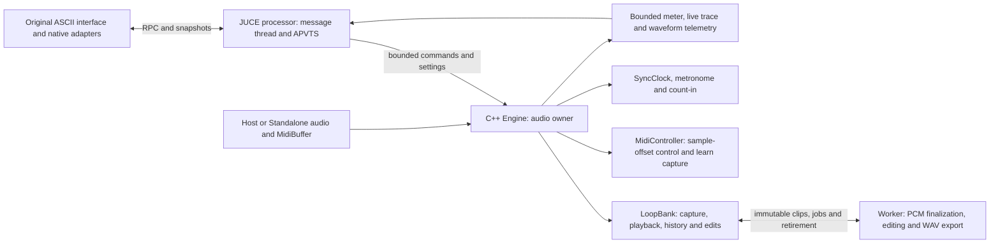

# Aion-Looper: audited implementation and migration blueprint

Audit baseline: source commit `e66a86c`, 21 October 2026. This document describes
what exists and separates it from the remaining target. It does not replace the
working implementation or claim complete Ascii-Looper parity.
Host-observation increment updated 22 October 2026; fresh evidence is in VALIDATION.md.
Windows VST3 pluginval and CLAP validator gates added 22 October 2026; their exact scope is recorded there.

## Repository and original reference

- `.reference/Ascii-Looper`: original browser application, including main.js,
  Modules, HTML/CSS, favicon and tests. Diagnostic `.reference/input-debug` is
  background material, not a runtime dependency.
- `resources/ui`: 16 preserved runtime files checked against the reference and
  SHA256 manifest. `tools/pack_ui.py` creates a deterministic embedded archive.
- `resources/native`: presentation/command adapters. The browser displays original
  HTML/CSS/layout and reused render methods; legacy WebAudio, inline event handlers
  and network imports are blocked. C++ owns audio. Unported controls stay disabled.
- `source/core`: JUCE-independent C++20 audio, timing, PCM ownership and MIDI.
- `source/plugin`: one JUCE processor/APVTS implementation shared by all formats.
- `source/ui`: embedded resource provider, browser window and native IPC entry.
- `tests`: unchanged-JS behavior/DSP oracles, native core/processor contracts and
  actual WebView2 pointer/key/browser-audio checks.
- `cmake`, `CMakeLists.txt`, `CMakePresets.json`: pinned dependencies, formats and
  platform builds. `docs/BUILDING.md` contains the exact toolchain/setup commands.

Keeping source assets unchanged does not mean all their features currently work:
see `PARITY.md`. The frontend adapters are needed to replace JS audio execution.
User-local logo changes in `resources/native/looper.js` are preserved separately.

## Implemented ownership graph



| Current owner | Implemented responsibilities | Remaining work |
| --- | --- | --- |
| `Engine` | Sample clock, input/loop/output path, command dispatch, parameter smoothing, bounded MIDI/telemetry | Complete transport arbitration, other DSP modules |
| `LoopBank` | 20 tracks, capture/OD/SUB, immutable PCM, local/global history, MULT/NORM/reverse, Start/RTRG/STUT, merge/export | Remaining editing/import/project state and broader audio acceptance |
| `MidiController` | Notes/CC/PC, 73 binding slots, loop volume/pan learn, OD/SUB/SUS, panic/overflow/disconnect cancellation | Other parameter learn, synth pitch/mod/velocity, MIDI clock and HID |
| `AionProcessor` | JUCE buses, processBlock, APVTS, saved parameters/MIDI, native device routing, IPC, WAV picker/write and validated block-stamped host observations | Full session/project persistence and host sync scheduling/arbitration |
| `AionWebEditor` | Embedded resources, WebView2 selection on Windows, native RPC, close/reload cancellation | Apple/Linux browser/device acceptance |

Names such as DroneBank, Tracker, FxRack, TransportArbiter and ProjectService in
`ARCHITECTURE.md` are planned module boundaries, not implemented classes. Introduce
one only when its original feature has a retained behavior and audio oracle.

## Current CMake configuration

JUCE is pinned to `9.0.4`, commit
`3fb5cbc0340758596dac39f7c8de47d562b4896e`. Official release verification:
https://github.com/juce-framework/JUCE/releases/tag/9.0.4

`cmake/Dependencies.cmake` checks the actual source revision, including local
FetchContent overrides. CLAP uses pinned clap-juce-extensions and its submodules.
JUCE already provides the LV2 wrapper; no separate legacy juce_lv2 fork is used.

The actual build has three shared targets:

```cmake
# Abridged from CMakeLists.txt; use the complete file for a build.
add_library(aion_core STATIC
    source/core/Engine.cpp source/core/LoopBank.cpp
    source/core/ReferenceDsp.cpp source/core/Wav.cpp
    source/core/MidiController.cpp)

juce_add_binary_data(AionUi NAMESPACE AionUi HEADER_NAME UiData.h
    SOURCES "${ui_archive}" # plus the six resources/native adapters
)

juce_add_plugin(AionLooper
    COMPANY_NAME "Jorge Salgueiro"
    BUNDLE_ID "com.jorgesalgueiro.aionlooper"
    PLUGIN_MANUFACTURER_CODE Jsal PLUGIN_CODE Aion
    PRODUCT_NAME "Aion-Looper" PLUGIN_NAME "Aion-Looper"
    FORMATS ${formats}
    IS_SYNTH FALSE NEEDS_MIDI_INPUT TRUE NEEDS_MIDI_OUTPUT TRUE
    IS_MIDI_EFFECT FALSE EDITOR_WANTS_KEYBOARD_FOCUS TRUE
    VST3_CATEGORIES Fx Tools
    LV2URI "https://github.com/jorgesalgueiro/Aion-Looper/plugins/main"
    NEEDS_WEB_BROWSER TRUE NEEDS_WEBVIEW2 TRUE
    MICROPHONE_PERMISSION_ENABLED TRUE
    MICROPHONE_PERMISSION_TEXT "Record audio into Aion-Looper."
    COPY_PLUGIN_AFTER_BUILD FALSE)

# CLAP is added separately by clap_juce_extensions_plugin(TARGET AionLooper ...).
# The full file also links aion_core/AionUi/JUCE, configures ASIO, resources,
# Linux's embedded browser subprocess, tests, install rules and CPack.
```

| Preset | Selected default formats | Backend / validation boundary |
| --- | --- | --- |
| `core` | No JUCE wrappers | Portable DSP/queue/reference tests; Windows also has an existing MSVC core tree |
| `windows` | Standalone, VST3, CLAP | WebView2; ASIO is opt-in and enabled in this PC's current cache; hardware/host gates separate |
| `linux` | Standalone, VST3, CLAP, LV2 | JUCE ALSA/JACK, WebKitGTK; current portable tests do not establish current Linux GUI/host acceptance |
| `macos` | Standalone, VST3, CLAP, AU, AUv3 | Xcode universal arm64/x86_64; CoreAudio/WebKit; requires a Mac |
| `ios` | Standalone, AUv3 | Xcode/iPhoneOS, CoreAudio/WebKit; device/signing/extension lifecycle unverified |

Windows BUILD_TESTING optionally accepts AION_PLUGINVAL_EXECUTABLE. This adds the
serial vst3_pluginval test against the built wrapper through the pinned local
validator; it does not change product formats, dependencies or portable tests.
The level-9 Windows host-interface matrix now passes, with actual DAW/hardware,
allocation instrumentation and other-format/platform acceptance still separate.
See BUILDING.md for opt-in commands; no tool is downloaded by CMake.

Options `AION_BUILD_STANDALONE`, `AION_BUILD_VST3`, `AION_BUILD_CLAP`,
`AION_BUILD_AU`, `AION_BUILD_AUV3`, `AION_BUILD_LV2` select formats.
`AION_BUILD_PLUGIN=OFF` enables offline JUCE-free core builds. AU is macOS-only;
AUv3 requires Apple SDKs and Xcode; iOS rejects desktop formats. `AION_ENABLE_ASIO`
is Windows-only. Backend availability is not proof of hardware validation.

Incremental Windows testing should build only the existing required targets:

```powershell
cmake --build build/windows --config Release --target AionLooper_Standalone aion_mouse_host aion_midi_processor_tests --parallel 2
cmake --build build/windows-core --config Release --parallel 2
ctest --test-dir build/windows-core -C Release --output-on-failure
build/windows/Release/aion_midi_processor_tests.exe
powershell -NoProfile -ExecutionPolicy Bypass -File tools/TestMouseWorkflow.ps1 -MidiOnly
```

Fresh configure/build instructions for Windows, Ubuntu, macOS and iOS, including
SDK locations and platform-only packaging, are in `BUILDING.md`. On this PC CMake
is under `.toolchain/vs2022/Common7/IDE/CommonExtensions/Microsoft/CMake/CMake/bin`;
use that executable when it is absent from PATH. Do not reconfigure an existing
build tree with another generator. Apple instructions are not local test results.
Do not run CPack after every feature. Only make the requested minimal test package
once its gates pass; the existing Standalone packager does not rebuild plugins.

## Real-time and UI contracts

- Audio owns mutable DSP state. Allocate pools, telemetry storage and workspaces
  before processing; prepare edits off audio and transfer immutable clip handles.
  Retire old storage off audio, never free a final shared owner in the callback.
- No browser/JSON/file/device-enumeration work or locks on audio. Keep bounded
  SPSC/POD communication and one producer per queue. Standalone MIDI routes through
  JUCE; do not add multiple hardware callback producers to the command SPSC.
- Preserve sample offsets and explicit queue overflow/panic recovery. Current
  processing caps inspected MIDI events at 256 and ordinary commands at 128/block.
- Browser snapshots/visualizers may drop telemetry; release/panic and accepted
  actions cannot silently disappear. Preserve cancellation/generation/identity
  guards through close/reload, clear/reset and worker completion.
- Existing allocation instrumentation checks C++ new/delete. Arbitrary C malloc
  interposition and all driver/host internals are not certified. 64/128 synthetic
  callback acceptance does not establish physical round-trip latency.
- Preserve original controls, layout and behavior. Only needed native audio/input/
  MIDI configuration may add coherent original-style UI. Ask before implementing
  a user-visible alternative to JS. Do not silently redesign behavior for parity.

## Remaining delivery gates

1. Maintain the current looper/MIDI gates before adding another feature. Keep the
   failing-before-fix cases, unchanged-JS state/audio comparisons and exact stereo
   capture checks; test 64/128 and retain cancellation/OOM/ownership coverage.
2. Port each remaining original audio path independently: input/loop/master FX,
   drone oscillator/voice/envelope paths, sampler and tracker. The synth/tracker/FX
   boxes are future modules; they do not exist merely because a diagram names them.
3. Port original project/import/export behavior with worker decoding/validation,
   explicit versioning and rollback; current APVTS/MIDI saving is not full project
   persistence. Preserve audio/history on failure.
4. Complete host transport (meter, loop range, seeks, starts/stops), MIDI clock
   input/output and explicit host/MIDI/internal arbitration. Current code observes
   host tempo/PPQ/sample/seconds, meter/bar/cycle markers and play/record state;
   its internal loop sync still uses the configured internal clock. Host fields
   are optional, audio-owned and published coherently, not a host sync scheduler.
   Full DAW sync and MIDI clock remain unimplemented.
5. Add remaining learn targets, synth MIDI and HID/gamepads as individually tested
   original interactions. Hardware evidence must come from actual devices, not
   synthetic packets. Existing PC0 and CC27 confirmations cover only that setup.
6. Compile/load/validate each requested wrapper and OS, then assess sustained
   worst-case CPU/underruns, device reconnect, host lifecycle, signing and release
   licensing. Windows/Ubuntu cannot compile or validate Apple products here.

No feature passes merely by compiling. Do not call the app production-ready or
claim bug-free completeness from the current test subset. Exact acceptance and
known limitations are recorded in `VALIDATION.md`, `REFERENCE_AUDIT.md`, `PARITY.md`.

## Audit validation

- Existing Windows JUCE/CMake configure and generation succeeded with the pinned
  local dependencies and Standalone/VST3/CLAP/ASIO enabled. The generated install
  script includes this blueprint (`build/architecture-audit-cmake.log`). No native
  wrapper or package was rebuilt just to change documentation.
- Full MSVC portable/reference regression suite: 18/18, 256.80s
  (`build/architecture-audit-windows.log`). No failing case or tolerance changed.
- Full Ubuntu portable/reference suite: 18/18, 446.04s
  (`build/architecture-audit-ubuntu.log`). The longer reference comparisons ran
  to completion; no failing case or tolerance changed.
- Latest feature-specific processor, real 64/128 GUI, exact stereo WAV, Ubuntu
  and sanitizer evidence remains in VALIDATION.md for baseline `e66a86c`; these
  checks were not all rerun for this documentation-only audit.

The audit preserves the existing user-local logo override and makes no new
hardware, DAW, Apple-platform or arbitrary-malloc certification claim.


### CLAP state restore validation (22 October 2026)

Actual CLAP format loading exposed missing host parameter-cache invalidation
after APVTS restore. AionProcessor now requests JUCE parameter-info refresh only
after accepting MIDI configuration and replacing APVTS state, outside its mutex.
The pinned wrapper maps this to CLAP values/text/info rescan. No UI, DSP algorithm,
parameter ID/range/default or state encoding changed. All three vendor state
reproducibility tests now pass. AION_CLAP_VALIDATOR_EXECUTABLE enables the optional
clap_validator CTest; see BUILDING.md and VALIDATION.md for commands and limits.


### Linux native test entry points (22 October 2026)

The shared Engine/LoopBank/MidiController/processor/editor ownership graph is
unchanged. The existing production-processor test target now also builds on
Linux, with explicit AION_TEST_NATIVE_PROCESSOR registration. The separate
AION_LINUX_CLAP_VALIDATOR_EXECUTABLE path enables a pinned official ELF CLAP gate.
Default portable builds remain validator-free. Native Debug build and host/GUI/
hardware acceptance must stay distinct; see VALIDATION.md for measured outcomes
and BUILDING.md for exact commands. No separate Linux DSP fork was introduced.


Host-routed processors now also avoid OS MIDI watcher creation. Only the actual
Standalone holder subscribes to physical device-list changes; plugin MIDI arrives
through the DAW. This keeps device discovery off audio and avoids requiring ALSA
sequencer hardware just to instantiate a plugin or synthetic processor. The
Standalone input/configuration interface remains unchanged.


### Linux VST3 acceptance entry point (22 October 2026)

AION_LINUX_PLUGINVAL_EXECUTABLE adds the opt-in serial linux_vst3_pluginval
CTest against the actual JUCE VST3 bundle. TestLinuxVst3.py pins official Linux
pluginval 1.0.4 and requires editor, state, automation and thread/fuzz completion
at level 9 with the recorded sample-rate/buffer matrix. It reuses the existing
Engine/LoopBank/MIDI/IPC/editor architecture without a Linux-specific DSP path.
This wrapper/editor-lifecycle gate is distinct from HTML interaction, actual
DAW/controller sessions, Release performance and allocation certification.
